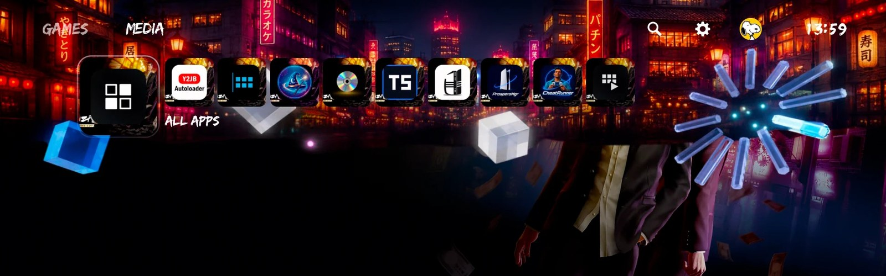

  

# PS5 Themes (ps5-theme)

Custom home-screen themes for jailbroken PS5 consoles on firmware 13.60 and
below, as an [etaHEN](https://github.com/GronedWaffel/etahen-11.00-13.60)
plugin or a standalone payload. Change the home screen's backgrounds, icons, sounds, fonts and home
music, keep as many themes as you like, and switch between them from the
console, a phone or a computer. The system is never written: every theme is a
read-only overlay held in memory, so the console is stock again the moment
the plugin stops, and the plugin puts your theme back each time etaHEN starts.

Version 1.59. Developed and tested on a PS5 with firmware 13.42, both with
etaHEN 2.5B (unified build) and on its own from PS5 Payload Manager.

> **About the screenshots.** They were taken from the author's own console.
> The test themes in them use Peanuts artwork, and the games shown use their
> publishers' artwork; both belong to their rights holders and are not part of
> this project. In the manager's screenshots the console's own pictures are
> blurred on purpose: system files stay on the console and are never
> redistributed. The photos of the console's screen show its interface as it
> appears.

## Contents

- [What it does](#what-it-does)
- [Requirements](#requirements)
- [Install](#install)
- [Running without etaHEN](#running-without-etahen)
- [Your first theme](#your-first-theme)
- [Documentation](#documentation): the guides and the technical pages in [`docs/`](docs/)
- [Firmware support and known limits](#firmware-support-and-known-limits)
- [Removing](#removing)
- [Development Approach](#development-approach)
- [Acknowledgements](#acknowledgements)
- [Licences and trademarks](#licences-and-trademarks)

## What it does

- **Themes tile and web manager.** A **Themes** tile on the home screen opens
  the manager in the console's browser. The same manager works from any
  phone or computer on your network at `http://<console-ip>:8095`.
- **Build a theme from parts.** Switch on what you want to change and add a
  file: background, icons, home music, system sounds, fonts, animations,
  video, textures and other images, the home screen's own tiles and the
  interface's icons.
- **Game and app icons.** Change the icon, background and logo of any
  installed game or app, homebrew and PlayStation Network artwork included.
  The Game Library shows them at once, and the home screen after rest mode;
  games and apps keep starting as before (see
  [Changing game and app icons safely](docs/challenges.md#changing-game-and-app-icons-safely)).
- **Any file, fitted for you.** One image fills every size of an asset. Any
  audio file is converted to the exact format and loudness of the sound it
  replaces, including the console's ATRAC9 home music. The browser does this,
  and the console checks every file again.
- **Appearance themes.** Replace the Control Center's bottom panel, the
  corner piece by the clock and the home screen artwork of the PlayStation,
  PlayStation 2, 3 and 4 themes, with placement and see-through parts (see
  [Appearance themes](docs/appearance-themes.md)).
- **Fonts.** Replace the text fonts the home screen and Settings draw with,
  for the home screen only (see [Fonts](docs/fonts.md)).
- **Home music editor.** Pick the part of a song to use, an optional loop
  part, the order they play in, how the joints sound and the loudness, then
  hear it before you apply it.
- **Preview pictures.** Each theme's card shows its background, or any
  picture you choose, so you can tell themes apart at a glance.
- **Save and Discard.** Changes are kept as unsaved until you save them, and
  Discard puts the theme back as it was.
- **Clear progress.** Applying shows what the console is doing and how far it
  has got.
- **Library tools.** Duplicate, export to a `.zip`, import a `.zip` or a folder
  (drag it in), and delete.
- **Comes back by itself.** The applied theme is put back every time etaHEN
  starts the plugin, after a reboot or an update. Only **Restore stock**
  stops it.
- **Never writes the system.** Nothing under `/system` or `/system_ex` is
  opened for writing, only media files can be themed, and every file is
  checked against the system file it replaces (see
  [what the checks cover](docs/how-it-works.md#what-the-checks-cover-and-what-they-dont)).

## Requirements

- A PS5 on firmware 13.60 or below, jailbroken, running etaHEN or any
  jailbreak with the standard ELF loader (see
  [Running without etaHEN](#running-without-etahen)). Tested on 13.42 with
  [etaHEN 2.5B unified](https://github.com/GronedWaffel/etahen-11.00-13.60/releases/tag/v2.5B-unified.1),
  which covers 11.00 to 13.60 except 11.40.
- A phone or computer on the same network is the easiest way to add files.
  The console's own browser works for applying and switching themes.
- To build from source: Docker. Nothing else on the host.

## Install

1. Copy `ps5-theme.plugin` to `/data/etaHEN/plugins/` on the console.
2. Turn on auto-start, so it runs whenever etaHEN runs. Either:
   - create an empty file `/data/etaHEN/plugins/ps5-theme.plugin.auto_start`, or
   - turn on auto-start for it in the etaHEN Toolbox plugin list.
3. Start it from the Toolbox, or jailbreak again.

On its first start the plugin lists the home screen's own assets (before any
theme is mounted), starts the manager on port **8095**, adds the **Themes**
tile, and shows a notification with the address to open from a phone or
computer.

**Updating:** copy the new `.plugin` file over the old one in
`/data/etaHEN/plugins/`. Within about 10 seconds the running plugin finds it,
starts it through etaHEN's ELF loader and hands over to it. Your theme stays
on the screen the whole time, and no Toolbox or restart is needed, which
matters after rest mode, when etaHEN's Toolbox is often gone. An open manager
page reloads itself with the new version. (This works from 1.23 on: to get
1.23 itself from an older version, restart the console once.) A newer
`ps5-theme.elf` or `.plugin` in `/data/ps5-theme/update/` works the same way,
with or without etaHEN.

**If the manager can't be reached:** start ps5-theme again (from the Toolbox
or PS5 Payload Manager). The new copy takes over from the running one even
when that one doesn't answer, and keeps your theme. If that doesn't help,
start `ps5-theme-stop.elf` from a payload loader or PS5 Payload Manager, then
start ps5-theme again. It stops the running copy and leaves your theme on the
screen, apart from the games' and apps' pictures until ps5-theme runs again
(see [Stopping without a restart](docs/how-it-works.md#stopping-without-a-restart)). No restart
is needed in either case.

## Running without etaHEN

The plugin doesn't need etaHEN, only a jailbreak: a kernel exploit and the
standard PS5 ELF loader (port 9021) that ps5-payload-sdk programs run under.
It gets its own privileges, and everything else is its own code. Every
release has both files, which contain the same program:

- `ps5-theme.elf`: for any ELF loader, such as
  [PS5 Payload Manager](https://github.com/itsPLK/ps5-payload-manager);
- `ps5-theme.plugin`: for etaHEN, the same program with etaHEN's header.

**With PS5 Payload Manager:**

- **Start it:** put `ps5-theme.elf` in a folder under
  `/data/pldmgr/payloads/` (or import it from USB) and launch it from the
  manager. It then does everything it does under etaHEN: the web manager,
  the Themes tile, and putting the selected theme back.
- **Start it after every jailbreak:** add it to the manager's autoload list.
- **Update it:** replace that `ps5-theme.elf` with the newer one (or put the
  newer one in `/data/ps5-theme/update/`). Within about 10 seconds the
  running copy finds it, starts it through the ELF loader and hands over,
  keeping your theme on the screen. Every build carries its version inside
  the program, which is how a plain `.elf` is recognised.

**Keeping both as a backup:** you can set up `ps5-theme.elf` in Payload
Manager and `ps5-theme.plugin` with auto-start in etaHEN at the same time.
Only one copy ever runs: when the second one starts, it finds the first, and
it exits if it isn't newer or takes over if it is. So whichever way starts
first, you get one copy, and the newest one.

**What's different without etaHEN:** nothing starts it at boot unless your
jailbreak or Payload Manager does. Both ways have been run on a PS5 with
13.42: `ps5-theme.elf` from PS5 Payload Manager, and `ps5-theme.plugin` from
etaHEN. If something works differently on your setup, the Activity page says
what happened.

## Your first theme

1. Open the **Themes** tile, or `http://<console-ip>:8095` on a phone or
   computer.
2. Press **New theme**, give it a name and press **Create**.
3. Press **Edit** on its card, switch on **Background** and drop in a picture.
   Add home music, icons or sounds the same way.
4. Press **Save** in the bar at the bottom, then **Apply to console**.
5. Give it a few seconds. The home screen may show the stock look for a
   moment while it switches.
6. **To hear new home music,** move to a game or app on the home screen that
   has its own music, so the console switches to that music, then come back.
   The console keeps playing the music it already had loaded and only picks
   up the theme's music when it starts the home music again.

To change only the music, make a theme with just **Home music**. Everything
else stays stock.

## Documentation

| Page | What's in it |
|---|---|
| [Changing game and app icons](docs/games-and-apps.md) | Installed games' and apps' icons, backgrounds and logos; the console's own tiles; interface icons |
| [Appearance themes](docs/appearance-themes.md) | The Control Center's panels and the home screen artwork of the PlayStation 1 to 4 themes: a step-by-step guide, what it needs, how it depends on the anniversary assets, and how they are made and stored |
| [Fonts](docs/fonts.md) | Replacing the console's text fonts, and which ones the home screen uses |
| [A tour of the manager](docs/manager.md) | Every page and control of the web manager |
| [How it works, and why](docs/how-it-works.md) | Overlays instead of writing the system, sandbox views, checks, staging, updating and stopping |
| [Theme format](docs/theme-format.md) | What a theme folder and its export contain |
| [Challenges and how they were solved](docs/challenges.md) | The problems met on the console and their solutions, including [changing game and app icons safely](docs/challenges.md#changing-game-and-app-icons-safely) and [finding the Appearance artwork](docs/challenges.md#the-appearance-themes-artwork) |
| [Testing](docs/testing.md) | The automated tests and the [tests on the console](docs/testing.md#tests-on-the-console) |
| [Building from source](docs/building.md) | Building the plugin and the tools, and the project layout |
| [Security](docs/security.md) | Who can reach the plugin, what protects the system, fuzzing |

Links to this page's old sections (from earlier release notes) land here;
the table says where each one is now.

## Firmware support and known limits

- Built for firmware up to 13.60; tested on 13.42 with etaHEN 2.5B unified.
- On other firmware, the asset list, sandbox views and tile registration are
  all discovered on the console, but they haven't been tried there. If a
  theme doesn't show, leave and re-enter the home screen, or jailbreak again;
  the theme is put back at start either way.
- New home music is heard only once the console starts its home music again:
  move to a game or app that has its own music, then come back (see
  [Home music](docs/manager.md#home-music)). Its position is kept by the console (see
  [Music that starts part-way through](docs/challenges.md#music-that-starts-part-way-through)).
- After rest mode, the plugin covers the new views ShellUI's restarted apps
  make (see [Stock again after rest mode](docs/challenges.md#stock-again-after-rest-mode)). An
  app that read its background before the overlay arrived may show stock
  until it reloads; **Re-apply** brings it back at once. etaHEN's own Toolbox
  stopping after rest mode is outside this plugin.
- Background and icon sorting is by file name. Anything it misses is under
  **Other images**.
- The home screen's layout can't be themed (it is code). Some of its colours
  live in the interface resource files' palettes, which the plugin doesn't
  change yet.
- Interface pictures: the console reads its resource files when the
  interface starts, so changed ones show after rest mode or a restart. The
  numbered test drew nothing beside the **Games** and **Media** tabs on 13.42.
  Whether the console draws your own picture inside a vector icon, and
  whether the home screen uses changed tile icons, hasn't been seen on the
  console yet.
- etaHEN's plugin **Stop** ends the plugin at once: overlays stay until you
  choose **Restore stock**, start the plugin again, or reboot.

## Removing

1. Choose **Restore stock**.
2. Delete `/data/etaHEN/plugins/ps5-theme.plugin*` and `/data/ps5-theme/`.
3. Delete the **Themes** tile from the home screen.

## Development Approach

This project explores AI-assisted development for PS5 homebrew, with an
emphasis on practical validation rather than accepting generated code at face
value.

Claude Code was used to assist with implementation, debugging and iterative
improvements. Development was guided by testing on physical PS5 hardware,
examining application logs, investigating observed failures and verifying
fixes on the console.

The project combines hardware testing with host-side automated tests to
exercise application behaviour, error handling and recovery scenarios. The aim
is to evaluate how AI-assisted development can be used to build a useful
console utility while maintaining a focus on reliability, safety and
reproducibility.

AI assistance does not replace testing or eliminate the need for continued
review. Firmware compatibility and known limitations are documented
separately.

## Acknowledgements

This project stands on the work of people who share what they learn with
everyone. My deepest gratitude to each of them. Without their work, their
openness and the time they gave freely, none of this would exist.

- **etaHEN**, by LightningMods and its contributors, and
  **[GronedWaffel](https://github.com/GronedWaffel)** for the
  [11.00–13.60 unified build](https://github.com/GronedWaffel/etahen-11.00-13.60)
  this was built and tested on. etaHEN is the foundation everything here runs
  on: the plugin format, auto-start and the Toolbox card installer, whose
  approach the Themes tile follows.
- **[ps5-payload-dev/sdk](https://github.com/ps5-payload-dev/sdk)**, by John
  Törnblom and contributors: the toolchain, the kernel access and the
  examples the whole plugin is built with.
- **[kstuff-lite](https://github.com/EchoStretch/kstuff-lite)**, by
  EchoStretch, which ships with the etaHEN build this was developed on.
- **[LibAtrac9](https://github.com/Thealexbarney/LibAtrac9)**, by Alex Barney
  (MIT License): the ATRAC9 codebooks and bitstream layout behind the
  encoder and the plugin's checks, and one of the two reference decoders in
  the tests. Without it, home music would not have been possible.
- **[FFmpeg](https://ffmpeg.org/)** and its ATRAC9 decoder, the second
  independent reference in the codec tests.
- **[ShadowMountPlus](https://github.com/drakmor/ShadowMountPlus)** by
  drakmor, **[PS5-File-Explorer](https://github.com/juma-sayeh/PS5-File-Explorer)**
  by juma-sayeh and **[onionHEN](https://github.com/aydencharles/onionHEN)**
  by aydencharles, whose home-screen app registration and navigation work
  etaHEN's Toolbox card builds on, and through it the Themes tile.
- **[ps5-webkit-autoloader](https://github.com/itsPLK/ps5-webkit-autoloader)**
  by itsPLK, which showed that a home-screen app can open a page served by a
  payload on the console itself.
- **[PSDevWiki](https://www.psdevwiki.com/ps5/)** and everyone who documents
  the PS5 there, in particular `param.json` and its `deeplinkUri`.
- **Zstandard and xxHash**, by Yann Collet and the zstd contributors: the
  format specification (RFC 8878) and the educational decoder that the
  plugin's decoder follows.
- **Microsoft's Direct3D documentation** of the BC7 format, which the texture
  encoder follows.
- **[PS5Themes](https://github.com/MasterPS0/PS5Themes)** by MasterPS0, whose
  theme packs showed which files hold the home screen's tab icons, tile icons
  and per-tile backgrounds.
- **[PS5SX2](https://github.com/Swordpdf/PS5SX2)** by Swordpdf and
  **[ATRACTool-Reloaded](https://github.com/XyLe-GBP/ATRACTool-Reloaded)** by
  XyLe-GBP, studied while working out how to get music onto the home screen.
- Everyone in the PS5 homebrew community who tests, reports and explains:
  your write-ups and answers made the hard parts possible.

## Licences and trademarks

Copyright (C) 2026 Blaze414

- **ps5-theme is free software under the GNU General Public License,
  version 3 or (at your option) any later version** (GPL-3.0-or-later). The
  full text is in [`LICENSE`](LICENSE). You may use, study, change and share
  it; if you share a changed version, it must stay under the same licence
  with its source available. It comes with no warranty.
- Why the GPL: the plugin is built with
  [ps5-payload-sdk](https://github.com/ps5-payload-dev/sdk), whose kernel
  interface is GPL-3.0-or-later (© John Törnblom), so the plugin as built is
  under the same terms.
- The ATRAC9 tables are generated from LibAtrac9, © 2018 Alex Barney, MIT
  License (`licenses/LibAtrac9.txt`), which allows their use in a GPL
  project.
- No system files are included. The plugin works with the files on your own
  console, and the stock copies it keeps never leave it.
- "PlayStation", "PS5" and "ATRAC" are trademarks of Sony Interactive
  Entertainment Inc. or Sony Group Corporation. This project is not
  affiliated with or endorsed by Sony.
- The screenshots in `docs/screenshots/` show the author's own test themes.
  The Peanuts characters in them belong to their rights holders, are not part
  of this project and are not covered by its licence.
