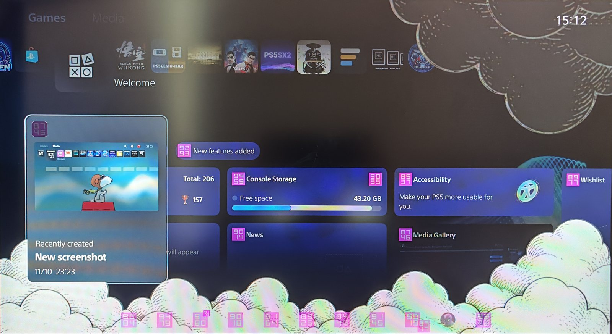
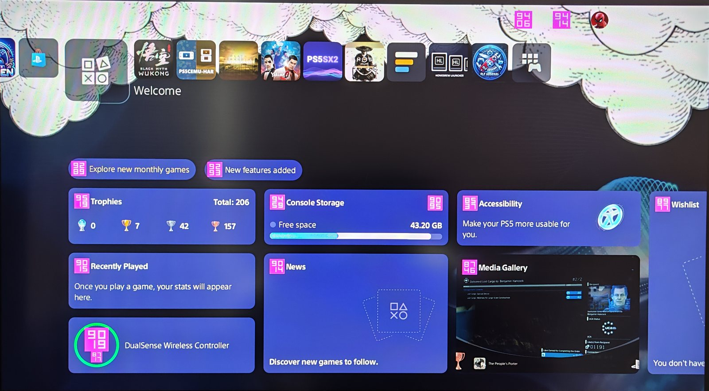
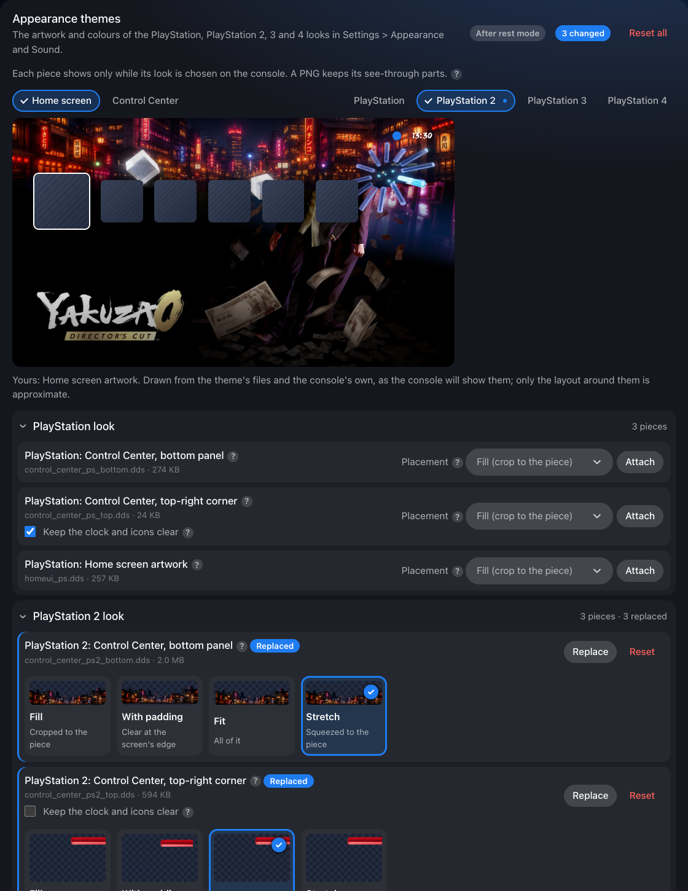
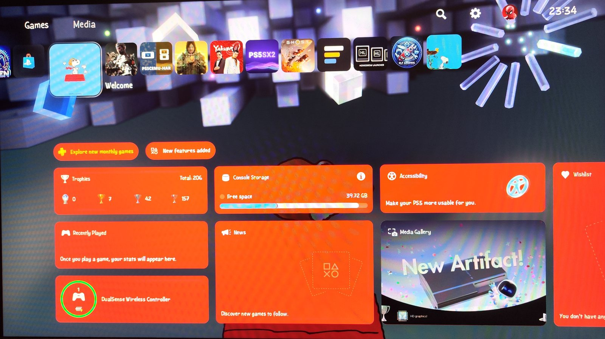

# Appearance themes

How to change the PlayStation 1 to 4 Appearance themes' artwork, what it needs, and how those textures are made and stored. Part of the [PS5 Themes](../README.md#documentation) documentation.

**On this page:**

- [Step by step](#step-by-step)
- [Changing a piece later](#changing-a-piece-later)
- [What it needs](#what-it-needs)
- [Colours](#colours)
- [How it depends on the anniversary assets](#how-it-depends-on-the-anniversary-assets)
- [How the Appearance textures are made](#how-the-appearance-textures-are-made)

The 30th anniversary Appearance themes (**Settings > Appearance and Sound**:
PlayStation, PlayStation 2, 3 and 4) each have three pieces of artwork a
theme can replace (version 1.56 and later):

- **Bottom panel:** the panel behind the Control Center's row of icons (the
  menu the PS button opens, on the home screen and in games).
- **Top-right piece:** the corner piece behind the clock and the search and
  settings icons.
- **Home screen artwork:** the artwork that hangs from the top of the home
  screen.

A piece shows only while its own Appearance theme is selected on the
console, and after rest mode. [How the Appearance textures are
made](#how-the-appearance-textures-are-made) explains the technical side.

*On the console: clouds on the PlayStation 2 theme's Control Center panel and
corner piece (the clock stays clear), and as its home screen artwork. The pink
numbers are the interface icons' numbered test, applied at the same time.*

## Step by step

1. **Make the picture.** A PNG or WebP, with transparent parts wherever the
   console's own artwork is clear (a JPEG covers the whole piece). Any size
   works, since it is fitted to the piece. The sizes below are the
   PlayStation 2 theme's; the other themes' pieces differ a little (the
   original PlayStation's bottom panel is 2560 by 880, its corner piece 1000
   by 560), and the page reads each piece's size from the console:

   | Piece | Size (PlayStation 2) | Notes |
   |---|---|---|
   | Bottom panel | 2560 by 820 | Sits behind the row of Control Center icons: keep it calm and not too light, so the icons stay readable. |
   | Top-right piece | 980 by 620 | The clock and the search and settings icons are drawn over its top band: a light picture there hides them. |
   | Home screen artwork | 2560 by 800 | Hangs from the top of the home screen. Sony's own is solid at the top and fades to clear by about two thirds of the way down: do the same, so the home screen's own background shows below it. |

   The home screen artwork is the Appearance theme's own layer, not the
   **Background** section's picture; the two are changed separately.
2. **Open the manager** at `http://<console-ip>:8095` on a computer or
   phone, make a theme (or press **Edit** on an existing one), and open
   **Appearance themes** in the list of parts. Each piece is a row named after its theme, for
   example **PlayStation 2: Control Center, bottom panel**, **PlayStation 2:
   Control Center, top-right corner** and **PlayStation 2: Home screen
   artwork**. Use the rows of the theme you have selected on the console.

   

3. **Choose how the picture is placed**, on the row, before or after
   attaching. Once a piece has your picture, its row shows each placement
   drawn on that picture, at the piece's own shape, with the see-through
   parts and the band kept clear for the clock, using the encoder's own
   placement: choose one by its picture (since 1.66):
   - **Fill** crops the picture to the piece and keeps the part against the
     screen's edge it meets (the bottom for the panel, the top for the
     artwork and the corner piece).
   - **Fill with padding** does the same and leaves a clear margin at that
     edge: set it in percent (0 to 40).
   - **Fit** shows the whole picture with clear sides, **Stretch** squeezes
     it to the piece.
   - **Keep the clock and icons clear** (corner piece, on by default) leaves
     the top band empty and puts the picture below it. Turn it off only for a
     picture that is dark there.
4. **Attach the picture:** press **Attach** on the row, or drop the file on
   it. The page makes the texture, the plugin checks it, and the row shows
   **Replaced** with a message that it was added and verified.
5. **Check it in the preview.** Above the rows, the part shows the home
   screen or the Control Center of one look (**PlayStation** to
   **PlayStation 4**, a dot marking those the theme changes) with your
   pieces drawn from the very textures the console will use, transparency
   included (since 1.66). A piece the theme doesn't replace is the console's
   own artwork, decoded from the console's texture by the plugin, and so is
   the background when the theme has none; a line under the picture says
   which pieces are yours and which the console's. The search, settings and
   Control Center icons and the tiles are the console's own too; only the
   layout around them is approximate. The preview follows the piece you
   attach or place.
6. **Adjust it.** Change the placement, the padding or the clock band and the
   texture is made again at once from the original the theme keeps (see
   [Changing a piece later](#changing-a-piece-later) for when it isn't,
   and what to do). The preview shows the new texture; judge the final
   result on the console.
7. **Save** the theme (the bar at the bottom) when you are happy, or
   **Discard** to go back to the last save.
8. **Apply**, then select the same Appearance theme in
   **Settings > Appearance and Sound** if it isn't, and put the console in
   **rest mode** and wake it. Press the PS button for the Control Center, and
   look at the home screen for the artwork. The manager says this after every
   change to a piece (attach, option change or reset), and the console shows
   a notification when the theme is applied.
9. **Go back.** **Reset** on a row removes your picture (and its kept
   original) from the theme; apply again. **No theme** in the library takes
   the whole theme off the console.

If it doesn't look right: a piece that stays as it was usually means a
different Appearance theme is selected on the console or the console wasn't
put through rest mode; a message that the theme was **applied partly** names
the file that was refused and why, in the **Activity** list.

## Changing a piece later

A piece's options (placement, padding, the clock band) apply the moment
they are changed: the plugin keeps the original
picture in the theme (`sources/`, not applied) and the page makes the texture
again from it, so nothing is attached twice. A picture attached before that
was added has no original kept, so the first change takes the picture back out
of the texture itself (the page reads the texture it made, with its see-through
parts), keeps it as the original and makes the texture again from it. Nothing
is attached again; what the earlier placement had cropped away, or left clear,
is not in that picture, so attach the original once more to get it back. Only
textures the page itself made can be read back this way.

**If an option doesn't take effect:** when a changed option does not make the
texture again by itself, or the look does not change after you apply the
theme again, change the option and then **attach the picture again** (Replace
on that piece). Attaching always makes the texture fresh with the options as
they are at that moment, so it works whenever the automatic step did not.
Then **Apply** the theme again and put the console in rest mode. The options
(placement, padding, the clock band) are kept with the theme (since 1.62), so
they are the same on every device you edit it from and go with an export.

## What it needs

- **Console:** a jailbroken PS5 on firmware 13.60 or below, with this plugin
  at **version 1.56 or later** (earlier versions don't know the folder).
  Tested on 13.42 with etaHEN 2.5B and with PS5 Payload Manager (the plugin
  or the standalone `ps5-theme.elf`); the textures' formats on other firmware
  have not been checked.
- **The anniversary Appearance themes must be on the console** (their
  textures in `/system/vsh_asset`; see [below](#how-it-depends-on-the-anniversary-assets)), and the one whose pieces you
  replaced must be selected in **Settings > Appearance and Sound**. Pieces of
  another theme are not drawn.
- **Apply the theme**, then put the console in **rest mode** and wake it. The
  interface reads these files as it starts.
- **A picture:** PNG or WebP for see-through parts (a JPEG has none, so it
  covers the whole piece). Any size: it is fitted to the piece. A browser with
  canvas and `BigInt` (current Chrome, Edge, Firefox or Safari) makes the
  texture, since the console does not.
- **The theme's firmware** must match the console (or be set to **Any
  firmware**), as for every theme.
- **For the corner piece:** a picture that is light at the top hides the
  clock; leave **Keep the clock and icons clear** on, or use a dark one.
- **Disk space:** the textures are stored without compression in the theme
  (BC7 is one byte per pixel: about 2 MB for the bottom panel, under 1 MB for
  the corner piece). With **Keep original pictures** on, the originals take
  their size too: one copy for each file a picture was attached to (it is sent
  only once; the console's storage has no hard links, so each is a copy).

## Colours

The **Appearance themes** section ends with **Colours** (1.59): the colours of
the parts the console tests found, for every Appearance theme at once.

**Only the default look's palette is offered.** With Use System Appearance for
Widgets off, the Welcome widgets, the Control Center and the button hints use
the default look's palette whichever Appearance theme is selected: on the
console, red picked there showed under the PlayStation 2 theme's artwork. The
PlayStation 1 to 4 palettes changed nothing visible in any test (an edit of
the PlayStation 2 palette, with red widgets, yellow text and a yellow accent,
didn't show anywhere), so the editor leaves them alone. A theme that changed
them earlier says so, with a button to put the console's colours back there.

**Turn off Use System Appearance for Widgets** in the Welcome hub's settings on
the console to see the widgets' colours. With it on, the Welcome hub picks the
widgets' colours for each Appearance theme itself and ignores these; the
manager says so at the top of the colours, on the widgets' colour, and after
saving a new one.

**Edit colours** opens one colour for each part the tests found on the
console:

| Colour | What it changes |
|---|---|
| **Welcome widgets and pills** | the Welcome hub's widget cards and the pills above them, with **Use System Appearance for Widgets** off in the Welcome hub |
| **Control Center backdrop** | the backdrop behind the Control Center; it also tints the Media Gallery card |
| **Control Center card** | the Control Center's card (Recently created) |
| **Button hints** | the background behind Utilities and Edit Widgets |
| **Text in Settings and menus** | every light text and label colour; dark labels on light buttons stay as they are |
| **Accent** | buttons, switches, sliders and progress bars: the colour that changes with the Appearance theme, its darker and lighter shades following it in proportion |

Each keeps the console's transparency. **Use these colours** saves them;
**Console's colours** puts the console's back. Apply the theme, then use rest
mode.

For finding what else the other colours change, **Tests** (folded under the
colours) has two: the **colour test** paints each kind of colour in a
bright colour of its own, and the **panel test** gives each panel and base mat
colour one of its own, each with a key.

Every palette lives in the same interface file (about 38 MB), and each change
rewrites it. Changes made one after another are queued: each starts from the
file as the one before left it, and the manager says when one is waiting. (In
the first 1.59 build, a second click made while the first was still saving
started from the old file and undid it, so only one palette took the test.)

What the test showed on a PS5 with 13.42:

| Kind (test colour) | What it changes |
|---|---|
| Base mat (magenta) | the backdrop behind the Control Center: with it open, the whole screen behind it |
| Panels (green) | the Control Center's cards, and the button hints at the bottom right (Utilities, Edit Widgets); also menus and dialogs |
| Text and labels (red) | the text in Settings and the system's menus: titles, the menu, the values. Some labels there stayed white |
| Accent (yellow), focus (cyan), icons (orange), background (blue) | not seen clearly in the first photos |

**The Welcome widgets follow these colours only with Use System Appearance
for Widgets off** (a setting in the Welcome hub). With it on, the Welcome hub
picks the widgets' colours for each Appearance theme itself (blue-violet with
the default look, grey with PlayStation, near-black with PlayStation 3), and
no file changes them: not the palettes, the backgrounds, the home artwork or
the panel picture. With it off, the colour test turned the widget cards and
the pills above them (Explore new monthly games, New features added) the
panels' green, and the Media Gallery card's tint the base mat's magenta; the
text on the cards stayed white.

**Panel test** tells the panel colours apart: it gives each of the 11 panel
colours and the 2 base mat colours a distinct colour of its own (the key lists
them), and leaves every other colour as the console's. With Use System
Appearance for Widgets off, a photo of the Welcome hub, the Control Center and
a menu shows which one colours the widgets, the pills, the Control Center's
cards and the button hints.

What the panel test showed, with the setting off:

| Colour name | What it changes |
|---|---|
| `menu.fill.enabled` (purple in the test) | **the Welcome widget cards, and the pills above them** |
| `base-mat.overlay.enabled` (teal) | **the backdrop behind the Control Center**, and the Media Gallery card's tint over its screenshot |
| `radio-button.overlay.fill.enabled` (magenta) | the Control Center's card (Recently created) |
| `key-guide.overlay.fill.enabled` (green) | the button hints' background (Utilities, Edit Widgets) |
| the other nine | nothing seen on the Welcome hub or in the Control Center |

A colour editor, with these kinds as named colours for each theme, follows the
tests.

## How it depends on the anniversary assets

Nothing here is added to the console: every piece replaces a texture that
Sony's own 30th anniversary Appearance themes already ship in
`/system/vsh_asset`, and the feature works only as far as those files do.

- **The files must be on the console.** The plugin lists the folder live from
  the console, so **Appearance themes** shows exactly the pieces that exist
  there. A console without the anniversary themes' textures shows none, and
  the plugin has nothing to replace. It carries no copy of Sony's textures.
- **Each piece is modelled on the console's own file.** The DDS header, the
  size, the number of mip levels and the zstd frame header of the file being
  replaced are read from it and copied, so a texture is accepted only if it
  matches that file byte for byte in all but its picture data. If a firmware
  changes a piece's size or format, the page follows the new file; a format it
  cannot write (anything but BC7) is refused with a reason.
- **The checked copy is the console's.** The first apply that touches the
  folder keeps a copy of it under `/data/ps5-theme/stock/<firmware>/`, checked
  against the system, and every apply builds the overlay from that copy with
  only your files replaced. The copy is per firmware, so an update to the
  console makes a fresh one.
- **A piece shows only with its own Appearance theme.** The pieces exist per
  theme (`ps`, `ps2`, `ps3`, `ps4`) and the home screen draws the ones of the
  theme selected in **Settings > Appearance and Sound**. Replacing the PS2
  pieces changes nothing while another theme is selected.
- **Sony can change them.** The names, sizes and formats above are those of
  13.42, where they were tested. The plugin checks each file against the
  console's own at every apply instead of assuming them, so a change on
  another firmware shows up as a refused file, not a broken screen.

## How the Appearance textures are made

How to change them is in [Appearance themes](#); this is
how it works.

The 30th anniversary Appearance themes (**Settings > Appearance and Sound**:
PlayStation, PlayStation 2, 3 and 4) draw their artwork from DDS textures in
`/system/vsh_asset`, not the `vsh_asset` folder under `/system_ex`:
`control_center_<theme>_bottom.dds` is the panel behind the Control Center's
row of icons, `control_center_<theme>_top.dds` the piece in the top-right
corner by the clock, and `homeui_<theme>.dds` the home screen's artwork
(`ps` is the original PlayStation). They are BC7; the PlayStation 2 theme's
are 2560 by 820 (bottom), 980 by 620 (corner) and 2560 by 800 (artwork), and
the other themes' differ a little. The home screen's code names them. They are plain files,
so a theme can replace them.

How they were found: the clock's capsule and the Control Center's backdrop
didn't turn into numbers in the numbered test, so they are not pictures in
the interface files. The file-level tracker (`ps5-assetwatch`) saw no file
load at all, because the home screen reads such files and closes them.
Naming the theme in use (PlayStation 2) led to the folder: [The Appearance
themes' artwork](challenges.md#the-appearance-themes-artwork) tells the whole story.

Two things had to be right for a replacement to be accepted, and both follow
the console's own files byte for byte (a texture made before 1.56, with the
old frame form, is rewritten with the system file's header when uploaded or
applied: the first 1.56 build skipped such files and reported "applied partly",
which is how this was found):

- **The format.** The DDS header is the system file's, copied unchanged. The
  files are zstd-compressed although their names end in `.dds`, so the plugin
  recognises compression by content. Their frame headers come in three forms
  on 13.42 (single segment `0xa0`, the same with a content checksum `0xa4`,
  and a windowed `0x80`); the page copies the form of the file it replaces,
  and writes the XXH64 content checksum when that form has one.
- **Transparency.** These textures are mostly clear: about half of a panel's
  pixels have no colour at all. Sony stores straight alpha and fills the
  clear pixels with colour (bright, mostly), so edges blend without dark
  fringes. The page encodes such textures as BC7 mode 6 with an alpha channel
  and does the same: clear pixels take the nearest visible colour, then white.
  A background texture stays opaque.

The textures show only while the matching Appearance theme is selected, and,
like every interface change, after rest mode. The manager lists them under
**Appearance themes** with plain names.

**Placing a picture.** These pieces sit against the screen's edge: the panel
at the bottom, the corner piece at the top right, the home screen's artwork
(solid at the top, fading to clear below) across the top. Each piece has a
**Placement** choice, made before the picture is attached: **Fill** (crop to
the piece, keeping the part against the screen's edge, so a wide picture
keeps its bottom clouds), **Fill with padding** (the same, leaving a clear
margin at that edge, in percent), **Fit** (the whole picture, clear sides) and
**Stretch**. First test on the console: a 16:9 cloud strip on the bottom
panel. Cropped around its centre it lost the lower clouds in the middle and
only the tall ones at the corners showed, and the clouds met the screen's
edge flat; placing it against the bottom edge, with padding, fixed both.

**The clock.** The corner piece is drawn over the clock and the search and
settings icons, which sit in its top band (the PlayStation 2 glass bar behind
the clock spans 7% to 22% of the piece, its glow 35%). A picture there that is
the clock's own white hides it: that was the second finding, a white cloud
there made the clock disappear. **Keep the clock and icons clear** (on by
default for the corner piece) leaves the top 26% empty and puts the picture
below it.

### How the anniversary assets are stored

Measured on 13.42 from the plugin's checked copy of the console's own files
(`/data/ps5-theme/stock/13.42/system/vsh_asset/`), for anyone building on
them.

**Where they are.**

| What | Where |
|---|---|
| The artwork: 12 textures, three per theme | `/system/vsh_asset/control_center_<theme>_bottom.dds`, `control_center_<theme>_top.dds` and `homeui_<theme>.dds`, `<theme>` being `ps`, `ps2`, `ps3` or `ps4` |
| The rest of that folder | the Welcome hub's backgrounds (22 JPEGs with thumbnails, 6 MP4s with thumbnails and placeholders) and a few PNGs (emoji, privacy and play-style pictures): 86 files, about 60 MB |
| The colours: one palette per theme, and one for the default look | `/system_ex/vsh_asset/Sce.PlayStation.PUI_UI3.rco`, the interface's resource file: file entries `color_ps1` to `color_ps4` (named `ps1` where the textures say `ps`) and `color_default`, type `color` |
| The previews in **Settings > Appearance and Sound** | `/system_ex/rnps/apps/NPXS40008/assets/src/modules/system/appearance/assets/texture/30thAnniv_Settings_Preview_<PS\|PS2\|PS3\|PS4\|PS5>_<CC\|list>.png`: for each theme, a picture of its Control Center (`CC`) and of its list |

`/system/vsh_asset` is the `/system` partition's own folder, not the
`/system_ex/vsh_asset` that holds the home backgrounds (there is a third,
`/preinst/vsh_asset`, with the boot movie). There is a **PS5** preview but no
`ps5` textures: the console's default look is drawn without these files, so
with it selected none of them is used.

**The colours.** Each palette is a JSON object of 92 names, each a colour as
a whole number, `0xAARRGGBB` (`"text.primary.enabled": 4294967295` is opaque
white), 4,143 bytes with Windows line ends. The five differ in their accent
(the default look's white, then grey `#333333`, blue `#367ed6`, purple
`#8d66ff` and light blue `#55bcf5` for PlayStation 1 to 4) and in their dark
fills for menus and dialogs (`#11141a`, `#101829`, `#172252`, `#251752`,
`#234e66`); their text and labels are white in all five. A theme may change
the numbers only: the plugin accepts a palette with the console's own names,
in the same order, each a whole number from 0 to 4294967295, and nothing else
in the file may change.

**The container.** Each file is one zstd frame holding a whole DDS file,
under a plain `.dds` name (no `.zst`). All twelve start
`28 b5 2f fd a0`: descriptor `0xa0`, a single segment with a 4-byte content
size (the DDS file's length), no dictionary and no checksum. Sony's use
compressed blocks; the console also reads a frame of stored (uncompressed)
blocks with the same header, which is what the page writes. Other textures
use other forms (the home backgrounds in `/system_ex/vsh_asset` are mostly
windowed, `0x80`, and one has a checksum, `0xa4`), so a replacement copies
the form of the file it replaces.

**The DDS header** is 148 bytes: `DDS `, the 124-byte header and the 20-byte
DX10 header.

| Field | Value in all twelve |
|---|---|
| flags | `0x00081007` (caps, height, width, pixel format, linear size) |
| linear size | the data's length: 16 bytes for every 4 by 4 block |
| depth, mip levels | 0 and 1 (no mipmaps) |
| pixel format | fourcc `DX10` |
| caps | `0x1000` (texture) |
| DXGI format | 98, `BC7_UNORM` (not the sRGB 99) |
| dimension, array size, misc | 3 (2D), 1, 0 |

After the header come the BC7 blocks, row by row, and nothing else.

**The sizes** (width by height; the decoded DDS, and the file on disk):

| Theme | Bottom panel | Top-right piece | Home artwork |
|---|---|---|---|
| `ps` | 2560 by 880 (2.25 MB, 280 KB) | 1000 by 560 (560 KB, 25 KB) | 2560 by 800 (2.05 MB, 263 KB) |
| `ps2` | 2560 by 820 (2.10 MB, 333 KB) | 980 by 620 (608 KB, 40 KB) | 2560 by 800 (2.05 MB, 365 KB) |
| `ps3` | 2560 by 900 (2.30 MB, 277 KB) | 800 by 320 (256 KB, 6 KB) | 2560 by 880 (2.25 MB, 261 KB) |
| `ps4` | 2560 by 848 (2.17 MB, 174 KB) | 1048 by 592 (621 KB, 29 KB) | 2560 by 832 (2.13 MB, 179 KB) |

Every piece is 2560 wide except the corner pieces, and no two themes share
all three sizes, so nothing can assume them: read each file's header.

**The pixels.**

- **BC7, mostly modes 5 and 6** (the two that carry alpha with the colour),
  with some 4 and 7 and a handful of 0 to 3: a full encoder's output. Any
  valid mode is read; a block whose first byte is 0 is a reserved mode, and
  the plugin refuses it.
- **Mostly clear.** 44% to 79% of each texture's pixels are fully
  transparent. The PlayStation 3 artwork has almost no fully opaque pixel:
  55% of it is half-transparent.
- **Straight alpha, with colour in the clear pixels.** Many half-transparent
  pixels have a colour brighter than their alpha, which premultiplied alpha
  can't, and the fully clear pixels keep a colour: white in most, grey in
  some (the PlayStation 2 bottom panel's average 169, 173, 180), so the
  edges blend without dark fringes when the texture is filtered.
- **Shapes.** A bottom panel is opaque from 45% to 63% of its height down to
  its bottom edge and clear above. A home artwork is solid from the top to
  39% to 54% of its height and clear by 54% to 77%. A corner piece is
  mostly clear, with what shows in its top half (the PlayStation 2 glass
  bar at 7% to 22% of it).

**How the console uses them.** The home screen reads the selected theme's
three files as the interface starts, then closes them (they are never
mapped), so a change shows after rest mode, and only for that theme.

**To replace one,** then: keep its name, read its header and copy it, make a
picture of exactly its size, encode BC7 with straight alpha and colour in the
clear pixels, wrap it in a zstd frame with the same descriptor and its length
as the content size, check it by decoding it again, and put it in place with
an overlay rather than writing `/system`. That is what the page and the
plugin do.

### The three pieces, and how each is made

| Piece | File (`/system/vsh_asset/`) | Size (PlayStation 2) | What it is | Placed against | Options |
|---|---|---|---|---|---|
| **Bottom** | `control_center_<theme>_bottom.dds` | 2560 by 820 | The panel behind the Control Center's row of icons (the PS button menu, on the home screen and in games) | the bottom edge | Placement, padding |
| **Top right** | `control_center_<theme>_top.dds` | 980 by 620 | The corner piece by the clock, with the search and settings icons | the top and right edges | Placement, padding, **Keep the clock and icons clear** |
| **Home screen artwork** | `homeui_<theme>.dds` | 2560 by 800 | The artwork that hangs from the top of the home screen (solid at the top, fading to clear below) | the top edge | Placement, padding |

`<theme>` is `ps`, `ps2`, `ps3` or `ps4`. Each Appearance theme has its own
three files, so a picture made for the PlayStation 2 pieces shows only while
the PlayStation 2 theme is selected.

How a piece gets onto the console, start to finish:

1. **The plugin lists the folder live.** `/system/vsh_asset` is an allowed
   target (the plugin only ever themes media), and is covered like the other
   asset folders: a read-only overlay of the staged folder over the real path
   and in the system's views of it. The console's own files are never
   written. The pieces appear in the manager under **Appearance themes**.
2. **The page makes the texture.** When you attach a picture, the page asks
   the plugin for the console's texture it replaces (its DDS header, size, and
   the zstd frame header of the file). It draws your picture on a canvas of
   the texture's size, as the piece's **Placement** says: against the piece's
   edge, with the padding left clear, and for the corner piece with the clock
   band left empty. It then fills the clear pixels with the colour of the
   nearest visible ones (white beyond 8 pixels), as Sony's files do, encodes
   BC7 mode 6 with an alpha channel, re-decodes a sample of the blocks to
   check the picture and the see-through parts, and wraps the result in zstd
   with the frame header of the console's file, and its checksum if that file
   has one.
3. **The plugin checks it again** on upload and at apply time: the DDS header
   identical to the system file's, the exact length, the same frame header
   bytes, the whole file one frame, and every BC7 block in a valid mode. A
   file that is right except for its frame header is rewritten with the system
   file's. Anything else is refused with a plain reason, so a bad texture
   never reaches the console.
4. **The original picture is kept** in the theme (`sources/`, never applied),
   so Placement, padding and the clock band can be changed later and the page
   makes the texture again at once. The **Keep original pictures** switch in
   the editor turns this off to save space.
5. **Apply** puts the overlays in place. The console reads the files when it
   builds the interface, which is why the change shows after rest mode.

What each piece needed, as found on the console:

- **Bottom:** a 16:9 picture centred on the panel lost its lower middle
  clouds and met the screen's edge flat. Placing it against the bottom edge,
  with padding, fixed both.
- **Top right:** the piece is drawn over the clock, which is white. A white
  cloud there made the clock disappear, so the top 26% can be kept clear.
- **Home screen artwork:** it hangs from the top, so placement and padding
  are measured from the top edge.
