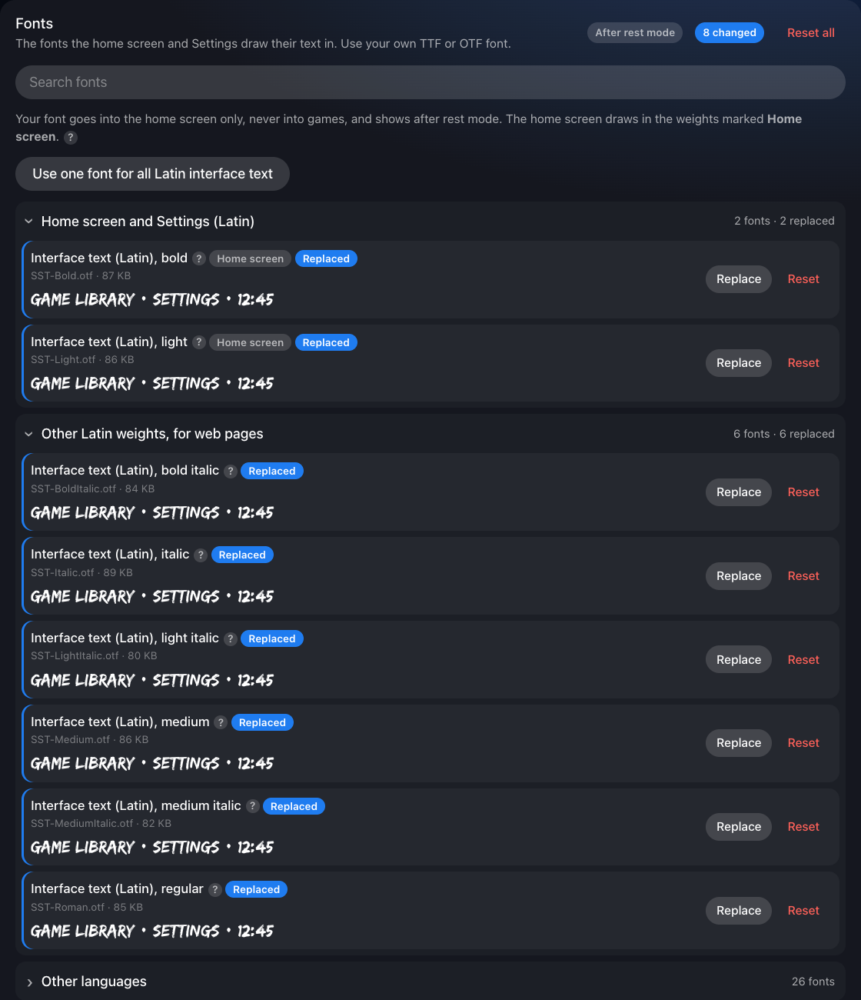

# Fonts

How the console's text fonts are replaced, and which ones the home screen uses. Part of the [PS5 Themes](../README.md#documentation) documentation.

The console keeps its text fonts as TrueType and OpenType files in
`/preinst/common/font`: `SST-*` for the interface's Latin text, with Arabic,
Thai, Vietnamese, Japanese, Korean and Chinese files beside them. Games read
the same folder, so a font put on the real folder would reach them. The
plugin puts a theme's font only where the home screen reads it: in ShellUI's
own view of the folder, as it does for game icons, once ShellUI's process
has been found, and takes it out of that view the moment ShellUI exits.
Other apps' views and the real folder keep the console's fonts.

Before a font is accepted, `src/font.c` reads its structure in memory. It
must be a whole TrueType or OpenType (CFF) font: its table list inside the
file, every table in bounds and none listed twice, the tables every font
needs (`cmap`, `head`, `hhea`, `hmtx`, `maxp`, `name`, `OS/2`, `post`) and its
outlines (`glyf` and `loca`, or `CFF `), with the glyph count, metrics and
glyph index tables agreeing, and a Unicode character map covering the
printable ASCII characters, so text doesn't come out with gaps. Collections
(`.ttc`) and WOFF files are refused. The console's own SST, Arabic and Thai
fonts pass the check, and so do common Latin fonts; symbol fonts and
single-script fonts without Latin punctuation don't.

**Which fonts the home screen uses.** The first console test replaced
`SST-Roman.otf` and nothing changed on the home screen, although the
plugin's log showed the overlay in ShellUI's view, before and after rest
mode. `ps5-fontscan.elf` (`tools/fonts`) lists the font files each process
has open or mapped, read-only. On a 13.42 console it showed that ShellUI
maps its fonts from the overlay's folder, so the overlay does reach it, and
that it uses only the **Light** and **Bold** weights: `SST-Light` and
`SST-Bold` for Latin text, with the Arabic, Thai, Vietnamese and Korean
Light and Bold files and the Japanese medium and bold. The regular and
medium Latin fonts (`SST-Roman`, `SST-Medium`) were mapped only by
`SceNKWebProcess`, the web renderer, so replacing them shows nothing on the
home screen. The manager marks the fonts the home screen uses and offers one
font for all the Latin weights at once. The two fonts in the system's
`font2` folders that ShellUI also maps (`DFHEI5-SONY2022.ttf`, `PS4Icon.ttf`)
can't be themed.

Fonts are read as the home screen starts, so apply the theme, then use rest
mode. If the home screen keeps restarting with a font, the crash guard takes
the theme down.
