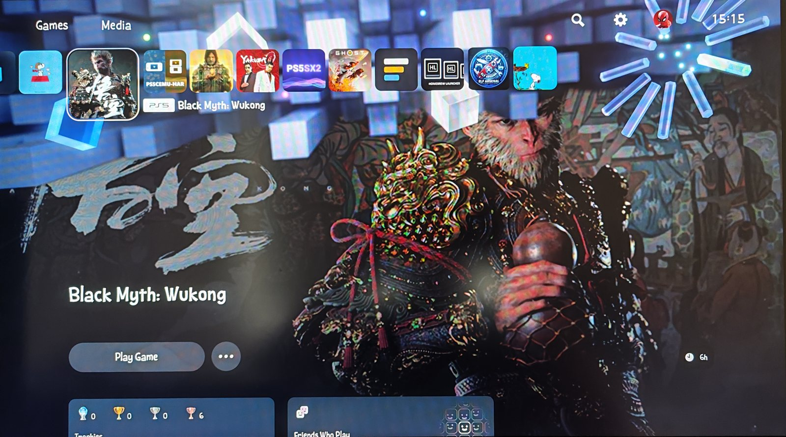
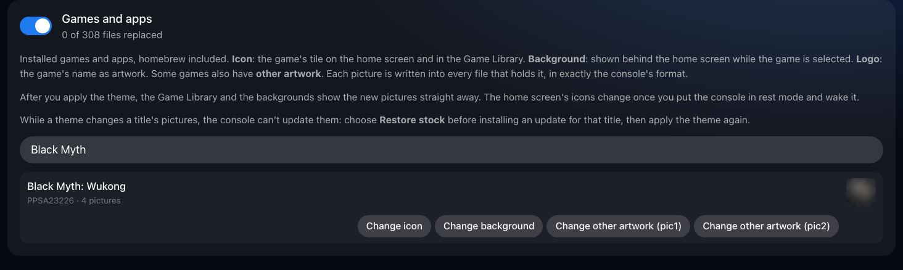
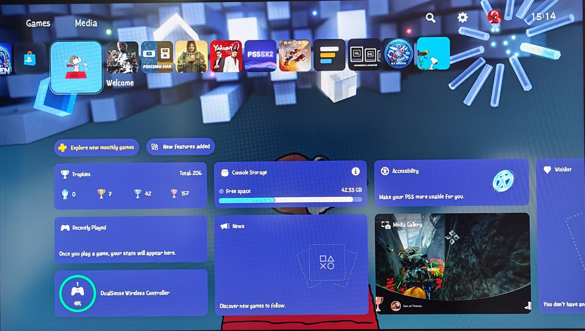
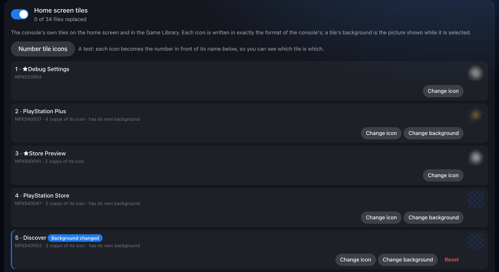
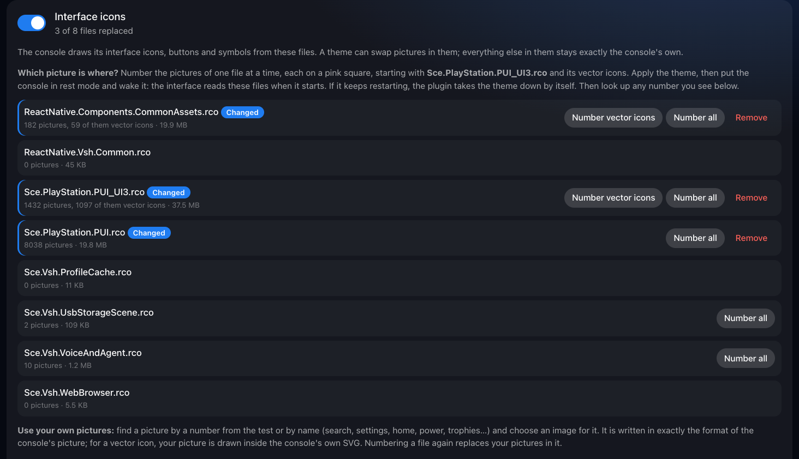

# Changing game and app icons

How to change installed games' and apps' icons, backgrounds and logos, and the console's own tiles and interface icons. Part of the [PS5 Themes](../README.md#documentation) documentation.

Any installed game or app, homebrew included, can get its own icon,
background and logo in a theme.

1. Open the manager and press **Edit** on a theme, or create one first.
2. Switch on **Games and apps**. Your installed games and apps are listed by
   name; when there are many, type in the search box.
3. Press the button for the picture you want to change:
   - **Change icon**: the game's tile on the home screen and in the Game
     Library.
   - **Change background**: the picture shown behind the home screen while
     the game is selected.
   - **Change logo**: the game's name as artwork, where the game has one.
   - **Change other artwork**: other pictures some games keep.

   Hold the pointer over a button to see where its picture appears.
4. Choose an image. Any size works: it's fitted as set in **How images are
   fitted** at the top of the page (fill, fit or stretch), then written in
   exactly the console's format into every file that holds that picture. The
   message says how many files were changed.
5. Do the same for other games, then press **Save** and **Apply to console**.
6. The Game Library and the backgrounds show the new pictures straight away.
   For the icons on the home screen, **put the console in rest mode and wake
   it**; the notification after applying says so too. After a console
   restart it's the same: the home row picks the icons up after the first
   rest mode.

*Black Myth: Wukong with an icon and a background chosen in a theme. The
game's artwork belongs to its publisher.*

**To undo** one game's pictures, press **Reset** on its row, then **Save**
and **Apply to console**. **Restore stock** takes the whole theme off.

**Good to know:**

- Before installing an update for a game whose pictures the theme changes,
  choose **Restore stock**, then apply the theme again afterwards: while the
  theme is applied, the console can't update that game's pictures.
- Some games' pictures come from PlayStation Network as WebP files. Safari
  can't make those, so use Chrome, Edge or Firefox for them.
- When two editions of a game share their PlayStation Network artwork, the
  row says "shares pictures with" the other, and changing one changes both.
- Games and apps keep starting while their pictures are changed. [Changing
  game and app icons safely](challenges.md#changing-game-and-app-icons-safely) explains
  how.

## The console's own tiles and interface icons

- **Home screen tiles** (PlayStation Store, Game Library, the Media tab's
  tiles and others): switch on **Home screen tiles**, then press **Change
  icon** or **Change background** on a tile. Not sure which tile is which?
  **Number tile icons** turns each icon into the number shown in front of its
  name.
- **Interface icons** (search, settings, the Control Center and more):
  switch on **Interface icons**, type a picture's name (search, settings,
  power and so on) in the lookup box, then choose an image. To find a
  picture by sight, use **Number vector icons**: apply the theme, use rest
  mode, then type the number you see into the lookup box.
- **Fonts**: in **Fonts**, replace the text fonts the home screen and Settings
  use. **Use one font for all Latin interface text** changes the Latin text
  in one step; fonts marked **Home screen** are the ones it draws with. See
  [Fonts](fonts.md).
- **Corner shapes**: in **Interface icons**, change how round the
  interface's buttons, switches, menus and other parts are, part by part
  (0 makes a part square-cornered), then press **Use these shapes**. The
  home screen's tiles keep their shape.
- **Appearance themes** (the Control Center's bottom panel and top-right
  piece, and the home screen artwork of the PlayStation 1 to 4 themes): see
  [Appearance themes](appearance-themes.md).
- Like game icons, all of these show on the home screen after rest mode.

