# A tour of the manager

Every page and control of the web manager. Part of the [PS5 Themes](../README.md#documentation) documentation.

**On this page:**

- [Library](#library)
- [Creating a theme](#creating-a-theme)
- [The edit page](#the-edit-page)
- [Applying](#applying)
- [Activity](#activity)
- [On a phone, and on the console](#on-a-phone-and-on-the-console)
- [The Themes tile](#the-themes-tile)

## Library

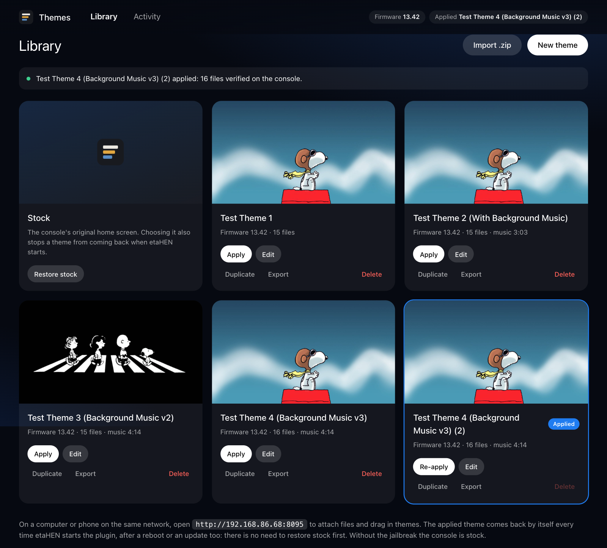

The library is the home page.

- **Cards:** each theme shows its preview picture, firmware, number of files,
  music length, and "unsaved changes" when it has some. The applied theme is
  outlined and tagged **Applied**.
- **Card buttons:** **Apply** (or **Re-apply**), **Edit**, **Duplicate**,
  **Export** and **Delete**. Delete asks for a second press. The applied
  theme can't be deleted.
- **Stock card:** **Restore stock** removes every overlay and stops the theme
  from coming back at the next start.
- **Top bar:** shows the console's firmware and what is applied, or what is
  being applied right now.
- **Banner:** under the title, the verified result of the last apply, such
  as "16 files verified on the console".
- **Import .zip:** imports a theme. You can also drop a `.zip` or a folder
  anywhere on the page.

The page refreshes by itself every few seconds, and every second while a
theme is being applied, so it stays correct even when you use it from two
devices at once.

## Creating a theme

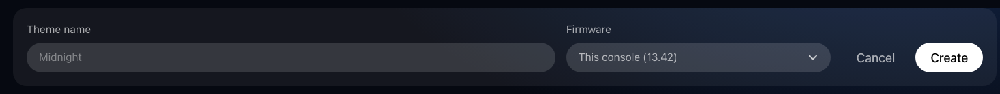

A theme needs only a name. **Firmware** is set to this console's firmware;
choose **Any firmware** on the edit page for themes you share. A theme made
for another firmware can be kept and edited but not applied, since system
files differ between firmware versions.

## The edit page

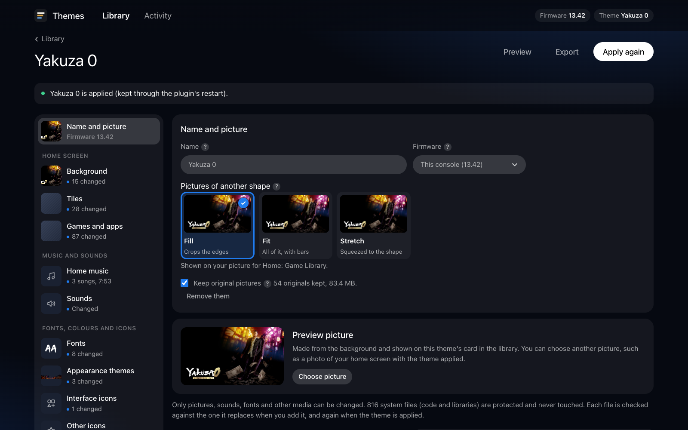

Open a theme with **Edit** on its card. The menu next to the title switches
between themes.

- **Name** and **Firmware.**
- **How images are fitted:** fill (crop the edges), fit (keep the whole
  picture) or stretch. When you attach a picture to a texture or an image,
  the theme keeps your original too (never applied to the console; one
  picture attached at several sizes is sent once, and the console keeps a copy
  for each). Changing this setting
  then makes every picture and texture that has a kept original again with
  the new fit, with a progress bar, and without attaching anything again.
  Pictures attached before originals were kept stay as they are, and a
  message says how many. The Appearance pieces have their own placement.
  If a changed fit does not show on the console after you apply the theme
  again, change the setting and then attach the pictures again: attaching
  always uses the setting as it is.
- **Keep original pictures:** on by default. Switch it off in a theme to save
  space: new pictures are then not kept, and fit and placement options apply
  when you attach a picture (as before). The line beside the switch shows how
  many originals are kept and what they take (a picture attached at several
  sizes counts once where the storage links them), with **Remove them** (click twice) to free the space;
  the theme's own files are not touched. The choice is stored with the theme
  (a file `originals-off` in its folder) and goes with a copy of it.
- **Export** and **Apply to console** act on the theme as it is now. They are
  available as soon as the theme has anything in it.
- **Preview** shows a home screen and a Control Center drawn from the theme:
  its background, its colours, the Appearance artwork and colours of the
  Appearance theme you pick (those the theme has artwork for are marked ✦),
  a changed font and up to six changed icons. It is drawn in the browser from
  the theme's files, sends nothing to the console, and is not the console's
  exact layout: the real look shows after you apply the theme and use rest
  mode. **Refresh** draws it again after a change.

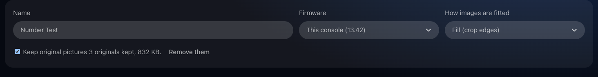

Below that, each part of the home screen has its own section with a switch.
Switching a section off asks before removing its files.

A **?** beside a setting, a section or a file says what it changes: point at
it, or tap it on a phone. Anything that takes a while (making a texture,
sending a file, numbering pictures) shows what it is doing in a message at the
top right, with a percentage, until it is done and verified. The bar only moves
forward, and changing a piece's placement shows its progress at once.

Parts of the page that wait for a large file from the console (the colours in
Appearance themes, the interface files, their corner shapes and the picture
lookup) show what they are reading and how far it has got. The interface files
are read once while the page stays open, and the file that holds the colours
and shapes is read first. If one can't be read, the page says so, with
**Try again**.

### Preview picture

The picture on the theme's library card. When you add a background, a
1280×720 picture is made from it, fitted the same way. **Choose picture**
uses any image instead, such as a photo of your TV with the theme applied.
**Remove picture** goes back to the background one. Preview pictures are
kept with the theme and exported with it, but never applied to the console.

### Background

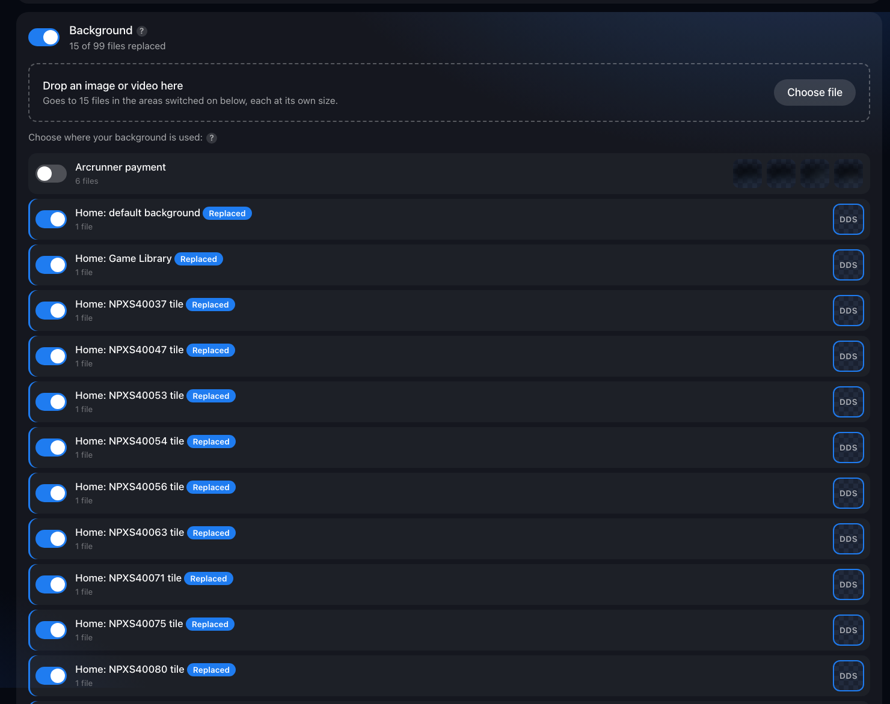

[Backgrounds](backgrounds.md) is the step-by-step guide.

One image or video for the home screen's backgrounds. The rows are the
places a background is used: the default home background, the Game Library,
each system tile's background, and other screens. Switch on the areas you
want, then drop in one file. It's encoded separately for each area, at that
area's own format and size. On 13.42 the home screen's backgrounds are
3840×2160 textures, and encoding one takes a few seconds in the browser.

### Icons and other images

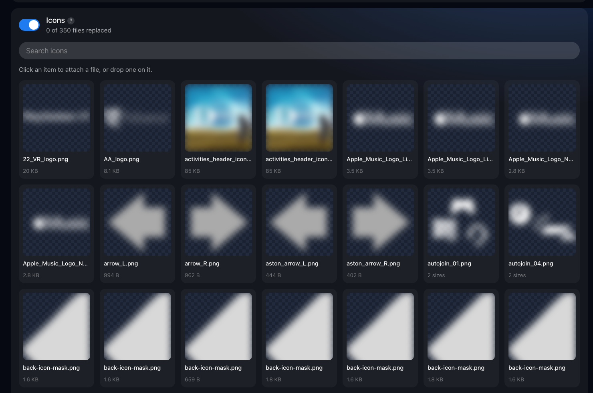

Icons are shown as tiles with search. Click a tile, or drop a file onto it.
Many icons exist in several sizes; your one file fills every size variant.
**Other images** works the same way for every other replaceable image.
(System artwork is blurred in these screenshots.)

### Sounds

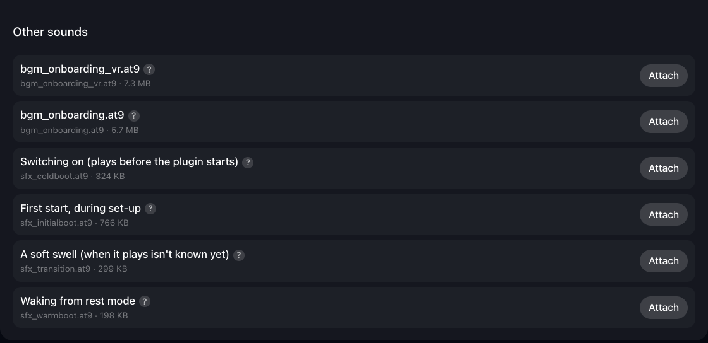

System sounds and music clips, such as the wake-from-rest chime. Any audio
file is converted to the sound's own format (WAV or ATRAC9) and loudness. The
cold-boot sounds play before the jailbreak, so a theme can't reach them.
`sfx_warmboot.at9`, the sound as the console wakes from rest mode, can be
replaced: see [The wake-up sound](home-music.md#the-wake-up-sound).

### Home music

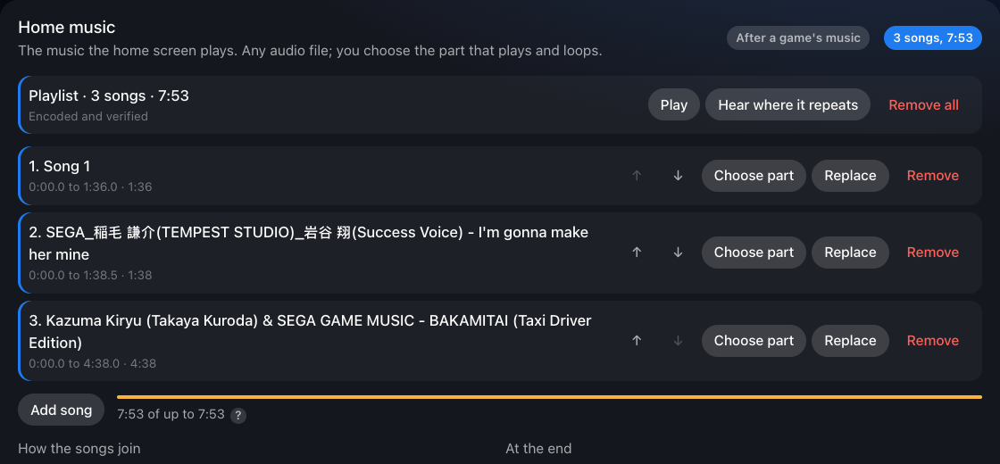

[Home music](home-music.md) is the step-by-step guide.

The music the home screen plays. Add any audio file the browser can play
(MP3, AAC, FLAC, WAV and so on). The section then shows:

- the music's length and whether it is "Encoded and verified";
- a player for the song the theme keeps;
- **Choose part**, **Replace** and **Remove**;
- **Add song**, which makes it a [playlist](home-music.md#playlists): the
  songs play one after another, each its own part. The section then lists
  them, with **↑** and **↓** to change the order and **Choose part**,
  **Replace** and **Remove** for each, how the songs join, what happens at
  the end, **Play**, and a bar showing how much of the console's length they
  use;
- **Loudness**, relative to the console's own music, from -12 to +12 dB.

The note at the bottom explains something the console does by itself: the
home screen keeps its place in the music. After a game it carries on where it
stopped, and when you apply a theme the new music carries on from about where
the old music had got to.

**Hearing the new music:** the console keeps playing the music it already
had loaded, so the theme's music doesn't start the moment it's applied. Move
to a game or app on the home screen that has its own music, so the console
switches to that music, then come back: the home screen then starts its music
again and plays the theme's. The same applies after a restart, since the home
screen loads its music before the jailbreak and the plugin start. The result
of the apply, the section's note and a notification on the console say so.

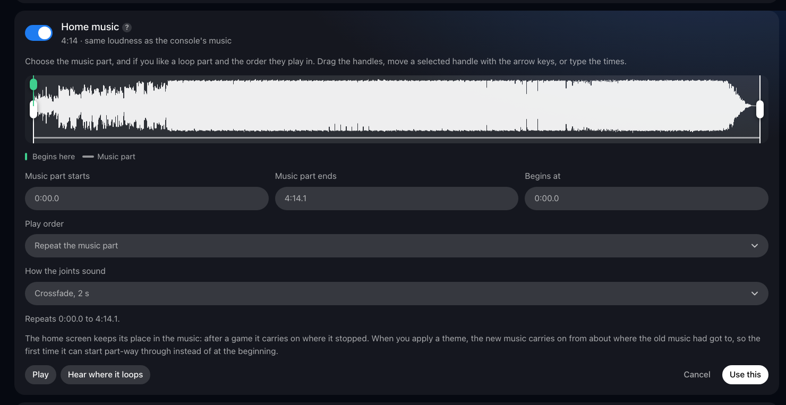

**Choose part** opens the music editor:

- **Music part:** drag the white handles on the waveform, move a selected
  handle with the arrow keys (the controller's D-pad works too), or type the
  times.
- **Play order:**
  - *Repeat the music part.* You can also choose where it begins (the green
    marker).
  - *Loop part first, then the music part repeats.* For example, open on the
    chorus.
  - *Loop part and music part take turns.*
  - *Music part once, then the loop part repeats.* An intro, like the
    console's own music.
- **How the joints sound:** a crossfade of 1, 2 or 4 seconds, a fade out and
  in, or a straight cut.
- **The summary line** says in plain words what will play, for example
  "Plays 0:30.0 to 1:20.0 once, then repeats 0:05.0 to 1:20.0".
- **Play** previews it exactly as the console will loop it. **Hear where it
  loops** and **Hear the change of part** play the seconds around each joint.
- **Use this** encodes and verifies the home music. **Cancel** leaves
  everything as it was.

### Fonts, animations, video and textures

- **Fonts:** replace one of the console's text fonts (the interface's own
  SST, and the Arabic, Thai, Vietnamese, Japanese, Korean and Chinese ones)
  with a TTF or OTF font of your own. See [Fonts](fonts.md) below.
- **Animations:** JSON animation and data files. They must be valid and keep
  their canvas size.
- **Video:** clips in the same container (MP4 or WebM).
- **Appearance themes:** the artwork of the PlayStation, PlayStation 2, 3
  and 4 themes in **Settings > Appearance and Sound**: the Control Center's
  bottom panel and top-right corner piece, and the home screen's artwork,
  then the colours of the Welcome widgets, the Control Center, the button
  hints, the text and the accent, for every Appearance theme (for the
  widgets, turn off Use System Appearance for Widgets in the Welcome hub's
  settings). See
  [Appearance themes](appearance-themes.md) and its
  [Colours](appearance-themes.md#colours).
- **Textures:** other system DDS textures. Any image is encoded to the
  texture's exact format and size.

### Interface icons

The console draws many of its interface icons, buttons and symbols (search,
settings, controller buttons and more) from resource files in
`/system_ex/vsh_asset`. This section lists them and how many pictures each
holds: on 13.42, `Sce.PlayStation.PUI_UI3.rco` holds 1,432.

**Use your own pictures:** type a picture's name (search, settings, home,
power, trophies and so on) or a number from the test into the lookup box,
then choose an image for it. It is written in exactly the format of the
console's picture. For a vector icon, your picture is drawn inside the
console's own SVG. **Reset** puts one picture back; with nothing typed, the
box lists the pictures the theme changes.

It also offers a test that shows which picture is where, one file at a
time. **Number vector icons** (start with these, in
`Sce.PlayStation.PUI_UI3.rco`) or **Number all** turns each picture of that
file into its own number on a pink square, drawn in exactly the format of
the console's own picture. Apply the theme, then put the console in rest mode
and wake it: the interface reads these files when it starts. Type any number
you see into the lookup box to find out which picture it is. **Remove** puts
the console's own pictures back. If the interface keeps restarting with the
theme applied, the plugin takes the theme down by itself (see
[When the interface keeps restarting](how-it-works.md#when-the-interface-keeps-restarting)).
On 13.42 the test showed, among others: search 9406 (`iconid_search`),
settings 9414 (`iconid_settings`), and the Control Center's Home, Switcher,
Notifications, Game Base, Music, Downloads, Sound, Mic, Accessories and Power
(`iconid_home`, `iconid_switcher`, `iconid_notification`,
`iconid_game_base`, `iconid_music`, `iconid_download`,
`iconid_sound_speaking`, `iconid_mic`, `iconid_game_controller_1`,
`iconid_power`). Nothing is drawn beside the **Games** and **Media** tabs.

**Corner shapes:** at the end of the section, **Corner shapes** lists how
round the interface's corners are, as the shape list in
`Sce.PlayStation.PUI_UI3.rco` gives them: buttons, switches, slider handles,
tooltips, menus, tags and so on, in pixels at 1080p, and at the end an
**Overall multiplier** (`borderRadiusRatio`). Change any number and
press **Use these shapes**; **Console's shapes** puts them back. Numbering
the file's pictures keeps your shapes. The plugin accepts the list only with
the console's own names, in the same order, each a plain number from 0 to
100 (0 to 10 for the multiplier), and nothing else in the file may change.
On the console, switches set to 0 came out square-cornered. The multiplier
at 3 changed nothing that could be seen, and the home screen's tiles keep
their shape whatever the numbers. Their corners are set in the home screen's program,
not in a file it reads (its own resource files hold only pictures), and the
plugin changes only pictures, sounds and data.

### Home screen tiles

The console's own tiles (PlayStation Store, PlayStation Plus, Game Library,
Media Gallery, Welcome and others) take their icons from each app's own
`icon0.png`, not from the interface files. This section lists them by name,
with **Change icon** (written in exactly the format of the console's icon,
every copy of it) and, where the tile has one, **Change background** (the
picture shown while the tile is selected). **Number tile icons** is the same
kind of test as above: each icon becomes the number in front of its name.
On 13.42 this was seen working on the console for the Games tab's tiles and
the Media tab's Discover, Music Home, All Apps, Live TV and App Library, and
Discover's own background.

### Games and apps

Every installed game and app, homebrew included, keeps its pictures in its
metadata folder, `/user/appmeta/<title ID>/`, and most PS5 games also in
the `sce_sys` folder of their installation, `/user/app/<title ID>/sce_sys/`.
This section lists them by name with a **Change** button for each picture,
which writes your picture into every copy of it, each in exactly the
console's format (PNG with the console's own chunks, BC7 or DXT1 textures
behind the console's own header). A title's `param.json`, license, keys,
trophies and everything else stay protected, and so does the rest of
`/user/app` and the plugin's own tile.

Some games' tiles show pictures the console downloaded from PlayStation
Network instead, kept per title in `/user/catalog_downloader/appmeta/<title ID>/`
and per game in `/user/catalog_downloader/conceptmeta/<concept>/`, a folder
that a game's editions share (on 13.42, Death Stranding Director's Cut's tile
points at `conceptmeta/234585`). The plugin reads from the console's app
database, read-only, which titles use which concept folder, and lists those
pictures with the title, so **Change** writes them too. These files are
WebP or JPEG pictures under `.png` names, often in numbered copies
(`icon0_11.png`, `logo_00.png` to `logo_30.png`): each is written in the
format it really holds, and the numbered copies count as the same picture.
Browsers that can't make WebP pictures (Safari) can't change those copies;
Chrome, Edge and Firefox can. When two installed titles share a concept,
changing that picture changes it for both.

The buttons name each picture by what it is: **Icon** (the game's tile on
the home screen and in the Game Library), **Background** (shown behind the
home screen while the game is selected), **Logo** (the game's name as
artwork) and, for some games, **other artwork**. Hovering a button shows
where the picture appears and which files hold it.

After you apply the theme, the Game Library and the backgrounds show the new
pictures straight away. The home screen's icons change once you put the
console in rest mode and wake it: the home screen reads them only as it
starts. The result of the apply, and a notification on the console, say so.

On firmware 13.42 the home screen (ShellUI) reads a title's pictures only
through its own sandbox's view of `/user`, by the paths in the console's app
database (for example `/user/app/<title ID>/sce_sys/icon0.png`), so that is
the only place the plugin puts them: never the real folders (the game
itself starts from them) or other apps' views. When ShellUI closes (rest
mode), the system's launcher (SceLncService) takes its sandbox down, and an
overlay left inside makes that fail, after which no game or app would start
(error CE-105733-9) until a restart. So a thread of the plugin's own watches
ShellUI's process and takes the overlays out of its sandbox the moment it
exits, also while the plugin is busy applying a theme, and nothing is put
into that sandbox afterwards. ShellUI's next sandbox is covered as soon as
its views appear, before the home row is read. Until the plugin has found
ShellUI's process, games' and apps' pictures wait, so on a firmware where it
can't be found they are never put in place. [PS5 game icons that stayed the
same](challenges.md#ps5-game-icons-that-stayed-the-same) and [Apps that wouldn't
start](challenges.md#apps-that-wouldnt-start) tell how this was worked out.

### Save and Discard

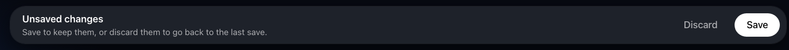

Your first change to a theme brings up this bar at the bottom of the page.

- **Save** keeps the changes.
- **Discard** asks once ("Discard all changes?"), then puts the theme back as
  it was at the last save. If the theme is applied, the console is updated to
  match.

Unsaved changes are kept if you leave the page or close the browser. The
library card says "unsaved changes", and a reminder appears when you leave.
Imported themes start out saved.

## Applying

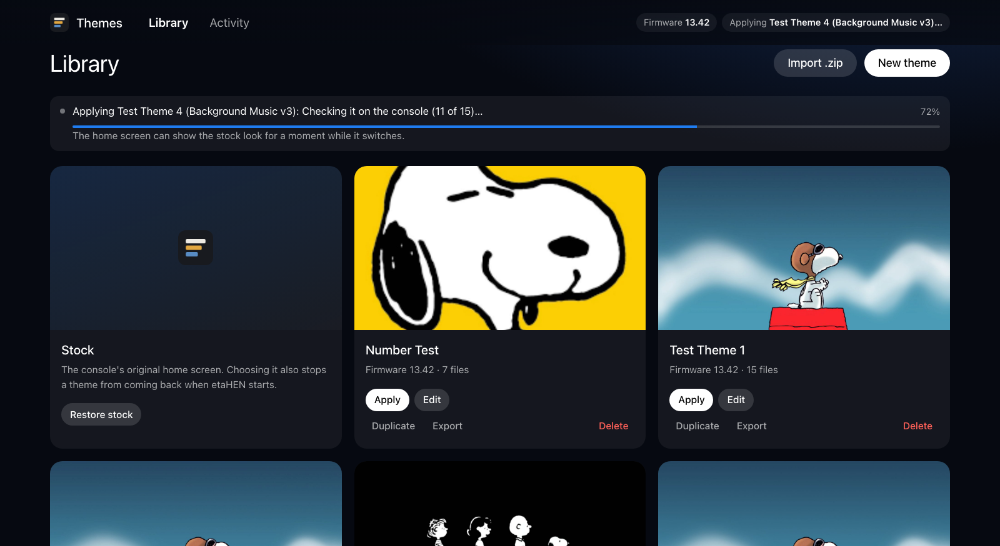

While a theme is applied, the library's banner shows what the console is
doing and how far it has got (on the other pages, a message in the corner
does):

1. **Keeping a copy of the system's files (first time only): 88 of 169 MB.**
   This happens only on the first apply on a firmware. It's the slow part,
   so it's counted in megabytes.
2. **Preparing the theme: 120 of 300 MB.** The console's storage can't share
   files between folders, so a theme's folder is a full copy. It's made once
   and reused until the theme or the system's files change.
3. **Switching to the new theme.**
4. **Checking it on the console (11 of 15).** Every screen that shows the
   theme is read back and checked.

The top bar says **Applying…** until the console confirms the result. The
same happens after a reboot, when the plugin puts your theme back. Applying
can take up to a minute the first time on a firmware, and about 20 seconds
when you change a theme or switch to one you haven't just used. Applying the
same theme again, switching back to the previous one, or putting it back
after a reboot, takes a second or two.

The console shows its own notifications too, so you can follow along on the
TV without the manager open: "Applying 'Name'…" (or "Putting 'Name' back…"
after a reboot), then for a long apply the current step and percentage, at
most every 8 seconds so they don't pile up, and finally "'Name' applied (16
files verified)".

## Activity

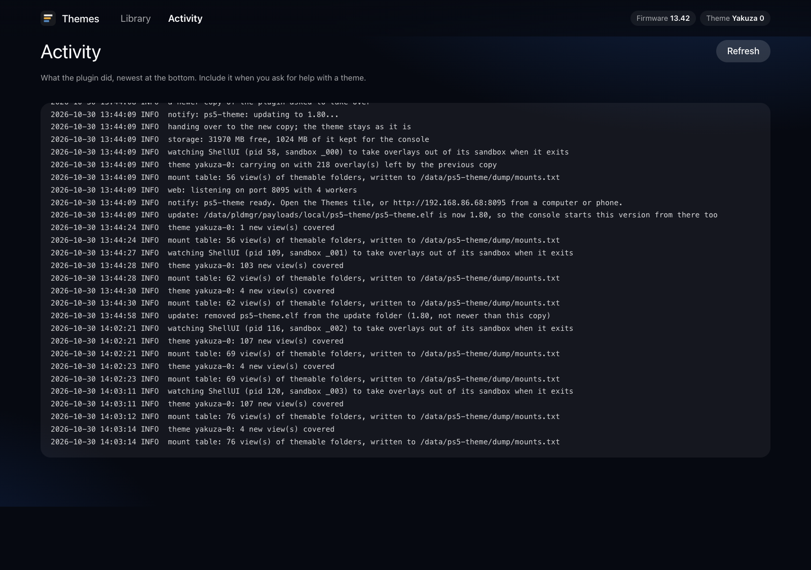

The plugin's log: what was applied, every overlay and the files checked
through it, uploads with their checksums, and any errors in plain words. A
crash report from a previous run appears here too.

## On a phone, and on the console

  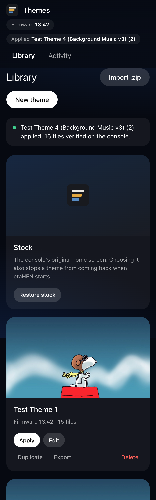
  &nbsp;
  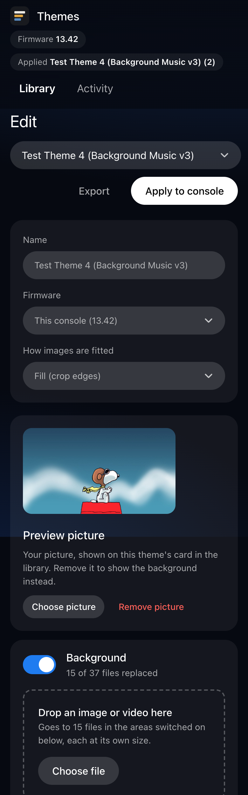

The manager works at phone width and in the console's own browser. A
selected control turns white and lifts, as in the console's own menus, and
the music editor's handles move with the D-pad. Adding files is easiest from
a phone or computer; the console's browser is best for applying and switching
themes.

## The Themes tile

The tile is a small home-screen app whose only content is a link that opens
`http://127.0.0.1:8095` in the console's browser. It is registered once and
kept across restarts.
