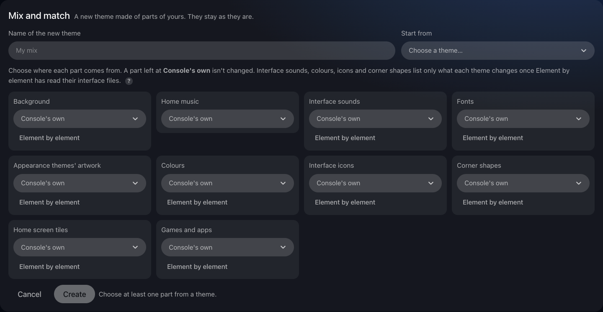
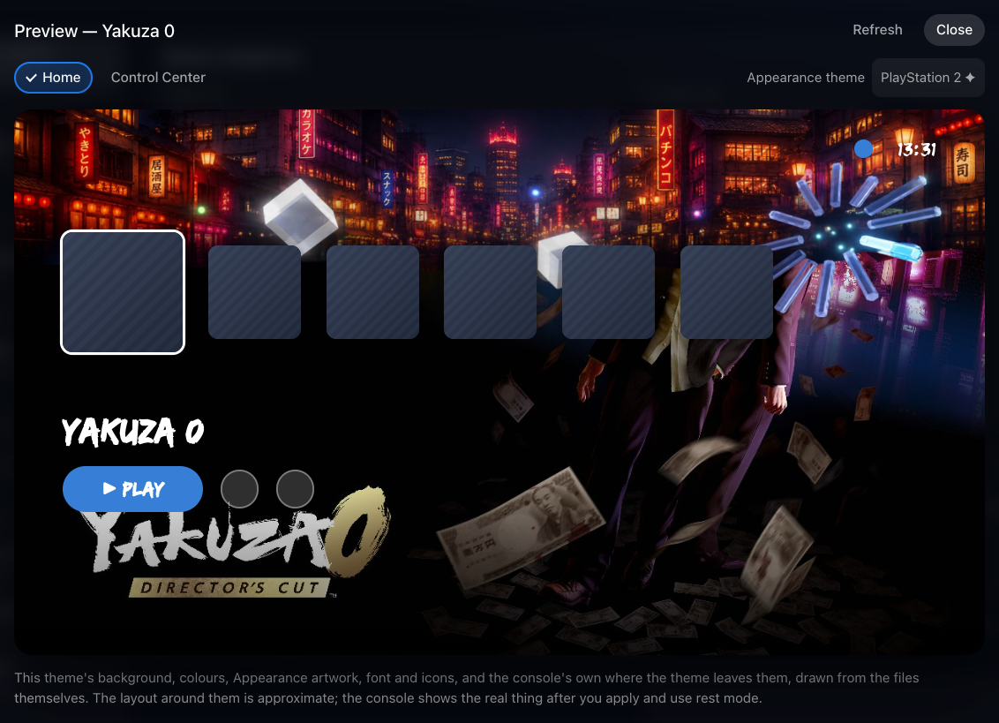
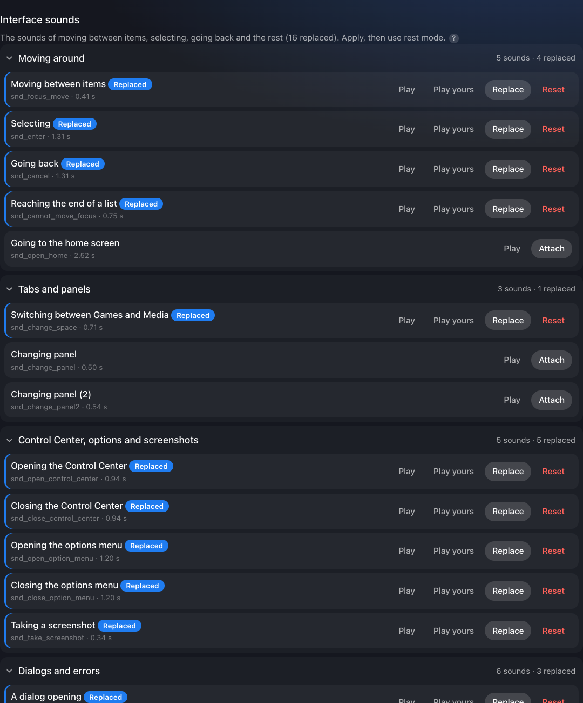
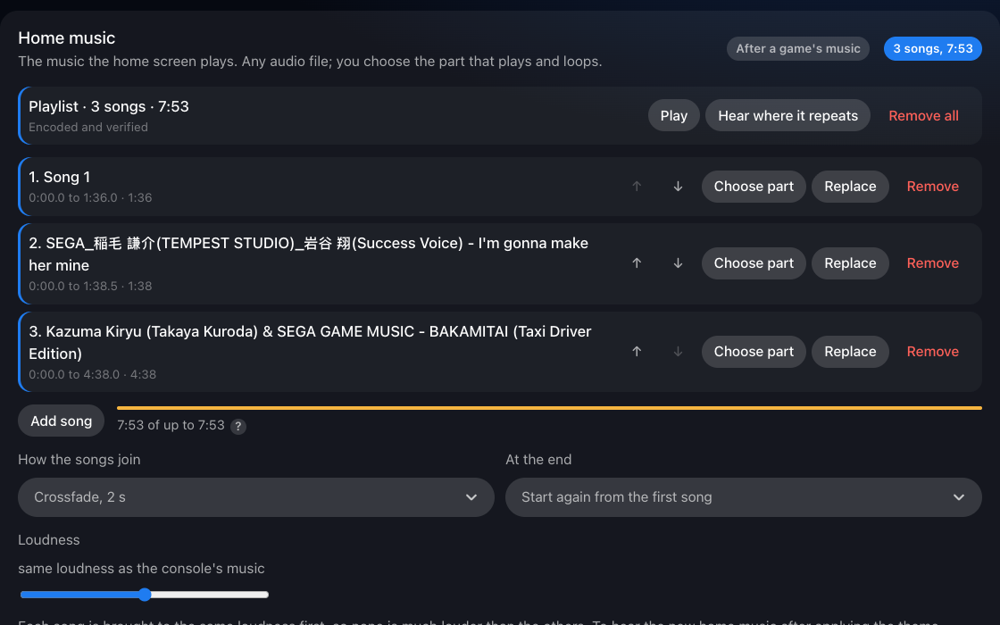
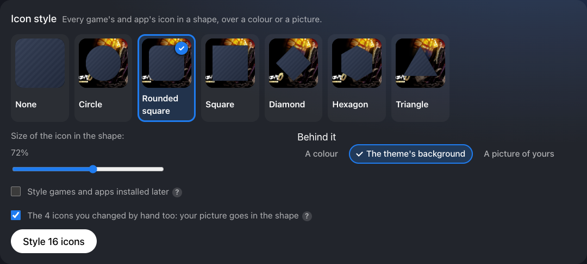
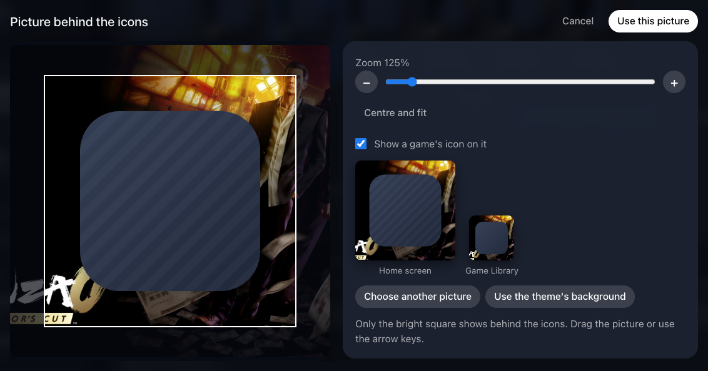

# A tour of the manager

Every page and control of the web manager. Part of the [PS5 Themes](../README.md#documentation) documentation.

**On this page:**

- [Library](#library)
- [Creating a theme](#creating-a-theme)
- [The edit page](#the-edit-page)
- [Applying](#applying)
- [Activity](#activity)
- [Messages](#messages)
- [When the console's storage is nearly full](#when-the-consoles-storage-is-nearly-full)
- [On a phone, and on the console](#on-a-phone-and-on-the-console)
- [The Themes tile](#the-themes-tile)

The screenshots are taken from the manager on a PS5 with 13.42, showing the
author's own test themes. Pictures the manager reads from the console itself
(its interface icons and artwork, and games' and apps' icons) appear in them
as plain striped stand-ins, and the parts list shows the manager's own
drawings: on your console you see the real ones.

## Library

The library is the home page.

- **Cards:** each theme shows its preview picture, number of files, music
  length, and "unsaved changes" when it has some. The firmware shows only
  when it isn't this console's ("Any firmware", or **Other firmware** with
  what to do about it). The applied theme is outlined and tagged **Applied**.
  Selecting a card's picture opens the theme, as **Edit** does.
- **Card buttons:** **Apply** (or **Apply again**), **Edit**, **Duplicate**,
  **Export** and **Delete**. Delete asks for a second press ("Press again to
  delete", for 6 seconds). A button that can't be used says why: an empty
  theme, another firmware, or (for Delete) the theme being applied.
- **No theme card:** **Remove the theme** removes every overlay and keeps the
  theme from coming back at the next start.
- **Top bar:** shows the console's firmware and the theme applied ("Theme
  None" without one), or what is being applied right now.
- **Banner:** under the title, the result of the last apply, such as "16
  files checked on the console".
- **Import theme:** imports a theme `.zip`. You can also drop a `.zip` or a
  folder anywhere on the page.
- **New theme** and **Mix and match** open a form above the cards; Escape
  closes it.
- **Mix and match** (with two themes or more, since 1.65): see below.

The page refreshes by itself every few seconds, and every second while a
theme is being applied, so it stays correct even when you use it from two
devices at once.

### Mix and match

**Mix and match** makes a new theme from parts of the ones you have: Snoopy's
background and icons, say, with another theme's home music and interface
sounds and a third one's font. The themes it takes from stay as they are.

- **Name** the new theme, then choose where each part comes from: one of your
  themes, or **Console's own** (that part isn't changed). **Start from** fills
  every part from one theme, to change a few of them afterwards.
- **The parts:** background, icons, home music (its songs, playlist and
  settings), sounds, interface sounds, fonts, the Appearance themes'
  artwork, colours, interface icons, corner shapes, home screen tiles, games
  and apps, and the rest (animations, video, textures and other images).
  Each list offers only the themes that have something of that part, and how
  many items each has.
- **Element by element** splits a part so each piece can come from its own
  theme: each background area (the default background, the Game Library, a
  tile's), each Appearance piece, each tile, game, font or sound, each
  interface sound, colour palette or interface icon. A piece left at **As the
  part** follows the part's choice.
- **Interface sounds, colours, interface icons and corner shapes** live in
  one interface file. Element by element reads it from each theme that has
  one (about 39 MB each on 13.42, read once while the form is open); after
  that, only the themes that change that kind are offered. The new theme's
  interface file is made on the device you're using, each entry taken from
  its own theme.
- **Create** makes the theme, saves it, and opens it in the editor, with the
  sections it uses switched on and the background's, Appearance pieces' and
  songs' own choices kept. Check it there, then apply it.
- Only themes for this console's firmware are offered, and parts are taken
  as each theme is now, unsaved changes included.

## Creating a theme

A theme needs only a name. **Firmware** is set to this console's firmware;
choose **Any firmware** on the edit page for themes you share. A theme made
for another firmware can be kept and edited but not applied, since system
files differ between firmware versions.

A new theme opens on its edit page with **Start here**: choose what to
change from the list of parts, press **Apply**, and use rest mode for what
shows only after it (fonts, Appearance artwork, interface icons and the home
row's icons).

## The edit page

Open a theme with **Edit** on its card, or by selecting its picture. The
title is the theme's name; **‹ Library** goes back.

The page is laid out like the console's Settings (since 1.66): a list of the
theme's parts on the left, the part you're changing on the right.

- **The list:** **Name and picture** first, then the parts in groups: Home
  screen (Background, Tiles, Games and apps), Music and sounds, Fonts,
  colours and icons, and Advanced (textures, video, animations and other
  images, folded away until a theme uses one; **Show** opens them). Each
  part has a small picture of what the theme puts there (your background,
  your first icon, "Aa" in your font), or else the console's own icon for
  that kind of thing (music, sound, photo, games and apps, the PlayStation
  shapes for the Appearance themes), and a line saying what it holds: "3
  changed", a song's length, or "Console's own". The console's icons are
  read from the console as the page runs (`/api/ui-icon`); none of Sony's
  pictures are part of the manager.
- **Each part has its own address** (`#/edit/<theme>/<part>`), so the
  browser's Back and Forward step through the parts you opened, and a link
  to one opens it directly. **Previous** and **Next** at the bottom of a part
  go to its neighbours in the list.
- **On a phone** the list comes first; a part opens on its own, with **‹ All
  parts** to go back to the list.
- **A part's head** says what it changes, how much the theme changes it, and
  when it shows where that isn't straight away ("After rest mode", "Home row
  after rest mode", "After a game's music"). **Reset all** puts back the
  console's own for the whole part, after asking.

**Name and picture** holds the theme's settings:

- **Name** and **Firmware.**
- **Pictures of another shape:** each choice is drawn on one of your own
  kept pictures, in the exact shape of the file it replaces, with the
  encoder's own arithmetic, so you see what Fill, Fit and Stretch do before
  choosing (a sample picture stands in until you have one). Fill (crop the edges), fit (keep the whole
  picture) or stretch, for each theme. When you attach a picture to a texture or an image,
  the theme keeps your original too (never applied to the console; one
  picture attached at several sizes is sent once, and the console keeps a copy
  for each). Changing this setting
  then makes every picture and texture that has a kept original again with
  the new fit, with a progress bar, and without attaching anything again.
  Pictures attached before originals were kept stay as they are, and a
  message says how many. The Appearance pieces have their own placement.
  If a changed fit does not show on the console after you apply the theme
  again, change the setting and then attach the pictures again: attaching
  always uses the setting as it is.
- **Keep original pictures:** on by default. Switch it off in a theme to save
  space: new pictures are then not kept, and fit and placement options apply
  when you attach a picture (as before). The line beside the switch shows how
  many originals are kept and what they take (a picture attached at several
  sizes counts once where the storage links them), with **Remove them** (click twice) to free the space;
  the theme's own files are not touched. The choice is stored with the theme
  (a file `originals-off` in its folder) and goes with a copy of it.
- **Export** and **Apply** (at the top of the page) act on the theme as it
  is now. They are available as soon as the theme has anything in it.
- **Preview** shows a home screen and a Control Center drawn from the theme:
  its background, its colours, the Appearance artwork and colours of the
  Appearance theme you pick (those the theme has artwork for are marked ✦),
  a changed font and up to six changed icons. Where the theme leaves
  something as it is, the console's own is drawn (since 1.66): its default
  home background and the Appearance themes' artwork, which the plugin
  decodes from the console's own textures to a quarter-size picture
  (`/api/asset/picture`, read-only), the system tiles' icons, the search,
  settings and Control Center icons, and the SST font. Only the layout around
  them is approximate: the real look shows after you apply the theme and use
  rest mode. **Refresh** draws it again after a change.

A **?** beside a setting, a section or a file says what it changes: point at
it, or tap it on a phone. Anything that takes a while (making a texture,
sending a file, numbering pictures) shows what it is doing in a message at the
top right, with a percentage, until it is done and verified. The bar only moves
forward, and changing a piece's placement shows its progress at once.

Parts of the page that wait for a large file from the console (the colours in
Appearance themes, the interface files, their corner shapes and the picture
lookup) show what they are reading and how far it has got. The interface files
are read once while the page stays open, and the file that holds the colours
and shapes is read first. If one can't be read, the page says so, with
**Try again**.

### Preview picture

The picture on the theme's library card. When you add a background, a
1280×720 picture is made from it, fitted the same way. **Choose picture**
uses any image instead, such as a photo of your TV with the theme applied.
**Remove picture** goes back to the background one. Preview pictures are
kept with the theme and exported with it, but never applied to the console.

### Background

[Backgrounds](backgrounds.md) is the step-by-step guide.

One image or video for the home screen's backgrounds. The rows are the
places a background is used: the default home background, the Game Library,
each system tile's background, and other screens. Switch on the areas you
want, then drop in one file. It's encoded separately for each area, at that
area's own format and size. On 13.42 the home screen's backgrounds are
3840×2160 textures, and encoding one takes a few seconds in the browser.

### Other icons and other images

Icons are shown as tiles with search. Select a tile, or drop a file onto it.
Many icons exist in several sizes; your one file fills every size variant.
**Other images** works the same way for every other replaceable image.

### Sounds

The interface's sounds come first (below), then **Other sounds**: the
console's sound files, named by when they play where that's known ("Waking
from rest mode") and otherwise by file name. Any audio file is converted to
the sound's own format (WAV or ATRAC9) and loudness. The
cold-boot sounds play before the jailbreak, so a theme can't reach them.
`sfx_warmboot.at9`, the sound as the console wakes from rest mode, can be
replaced: see [The wake-up sound](home-music.md#the-wake-up-sound). Every
file in the list takes any audio, a simple beep included (since 1.62:
`sfx_transition.at9` refused a pure tone before). The section's summary
counts the interface sounds the theme replaced too.

#### Interface sounds

At the top of the part, **Interface sounds** lists the sounds the interface makes as
you use it (since 1.62), in groups (since 1.66): **Moving around** (moving
between items, selecting, going back, the end of a list, going home),
**Tabs and panels** (switching between Games and Media with L1 and R1,
changing panel), **Control Center, options and screenshots**, then
**Dialogs and errors**, **Switches, boxes and sliders**, **Notifications and
trophies**, **Keyboard and voice**, **Parties, sign-in and purchases**,
**Set-up, controller and PS VR2** and **Other**. The first three are open;
the others fold away with how many sounds they hold, and a group with a
sound the theme replaced opens by itself. The PlayStation,
PlayStation 2, 3 and 4 Appearance themes' own moving, selecting and
going-back sounds follow.

- **Play** plays the console's sound on the device you're using; **Play
  yours** plays the theme's.
- **Attach** takes any audio file. It starts at its hit, as the console's
  sounds do (they get loud within 5 to 35 ms): silence and anything quieter
  before the hit are cut, keeping the last 10 ms faded in, so it plays the
  moment you press. A clip from a game often has a quiet stretch before its
  hit that would otherwise be heard as a delay. It is made as loud as the
  sound it replaces, and can be as long as the console's sound at most
  (moving between items is 0.41 seconds on 13.42); a longer one is cut with
  a short fade.
- A sound attached before this (1.62's first builds) that gets loud late
  shows **yours gets loud … s after you press** and **Start at the hit**,
  which trims it the same way without attaching it again.
- Apply, then put the console in rest mode and wake it: the interface reads
  its sounds as it starts.
- The controller's vibration patterns, which sit beside the sounds, stay the
  console's.

How the sounds are written, byte for byte in Sony's layout, is in
[Interface sounds, in Sony's layout](how-it-works.md#interface-sounds-in-sonys-layout).

### Home music

[Home music](home-music.md) is the step-by-step guide.

The music the home screen plays. Add any audio file the browser can play
(MP3, AAC, FLAC, WAV and so on). The section then shows:

- the music's length and whether it is "Encoded and verified";
- a player for the song the theme keeps;
- **Choose part**, **Replace** and **Remove**;
- **Add song**, which makes it a [playlist](home-music.md#playlists): the
  songs play one after another, each its own part. The section then lists
  them, with **↑** and **↓** to change the order and **Choose part**,
  **Replace** and **Remove** for each, how the songs join, what happens at
  the end, **Play**, and a bar showing how much of the console's length they
  use;
- **Loudness**, relative to the console's own music, from -12 to +12 dB.

The note at the bottom explains something the console does by itself: the
home screen keeps its place in the music. After a game it carries on where it
stopped, and when you apply a theme the new music carries on from about where
the old music had got to.

**Hearing the new music:** the console keeps playing the music it already
had loaded, so the theme's music doesn't start the moment it's applied. Move
to a game or app on the home screen that has its own music, so the console
switches to that music, then come back: the home screen then starts its music
again and plays the theme's. The same applies after a restart, since the home
screen loads its music before the jailbreak and the plugin start. The result
of the apply, the section's note and a notification on the console say so.

**Choose part** opens the music editor:

- **Music part:** drag the white handles on the waveform, move a selected
  handle with the arrow keys (the controller's D-pad works too), or type the
  times.
- **Play order:**
  - *Repeat the music part.* You can also choose where it begins (the green
    marker).
  - *Loop part first, then the music part repeats.* For example, open on the
    chorus.
  - *Loop part and music part take turns.*
  - *Music part once, then the loop part repeats.* An intro, like the
    console's own music.
- **How the joints sound:** a crossfade of 1, 2 or 4 seconds, a fade out and
  in, or a straight cut.
- **The summary line** says in plain words what will play, for example
  "Plays 0:30.0 to 1:20.0 once, then repeats 0:05.0 to 1:20.0".
- **Play** previews it exactly as the console will loop it. **Hear where it
  loops** and **Hear the change of part** play the seconds around each joint.
- **Use this** encodes and verifies the home music. **Cancel** leaves
  everything as it was.

### Fonts, animations, video and textures

Fonts come in groups (since 1.66): the ones the home screen and Settings
draw with, the other Latin weights (web pages), and other languages. A font
of yours shows a line of sample text in it. The Appearance themes' pieces
come in a group per look.

- **Fonts:** replace one of the console's text fonts (the interface's own
  SST, and the Arabic, Thai, Vietnamese, Japanese, Korean and Chinese ones)
  with a TTF or OTF font of your own. See [Fonts](fonts.md) below.
- **Animations:** JSON animation and data files. They must be valid and keep
  their canvas size.
- **Video:** clips in the same container (MP4 or WebM).
- **Appearance themes:** the artwork of the PlayStation, PlayStation 2, 3
  and 4 themes in **Settings > Appearance and Sound**: the Control Center's
  bottom panel and top-right corner piece, and the home screen's artwork,
  then the colours of the Welcome widgets, the Control Center, the button
  hints, the text and the accent, for every Appearance theme (for the
  widgets, turn off Use System Appearance for Widgets in the Welcome hub's
  settings). See
  [Appearance themes](appearance-themes.md) and its
  [Colours](appearance-themes.md#colours).
- **Textures:** other system DDS textures. Any image is encoded to the
  texture's exact format and size.

### Interface icons

The console draws many of its interface icons, buttons and symbols (search,
settings, controller buttons and more) from resource files in
`/system_ex/vsh_asset`. This section lists them and how many pictures each
holds: on 13.42, `Sce.PlayStation.PUI_UI3.rco` holds 1,432.

**Use your own pictures:** type a picture's name (search, settings, home,
power, trophies and so on) or a number from the test into the lookup box,
then choose an image for it. It is written in exactly the format of the
console's picture. For a vector icon, your picture is drawn inside the
console's own SVG. **Reset** puts one picture back; with nothing typed, the
box lists the pictures the theme changes.

It also offers a test that shows which picture is where, one file at a
time. **Number vector icons** (start with these, in
`Sce.PlayStation.PUI_UI3.rco`) or **Number all** turns each picture of that
file into its own number on a pink square, drawn in exactly the format of
the console's own picture. Apply the theme, then put the console in rest mode
and wake it: the interface reads these files when it starts. Type any number
you see into the lookup box to find out which picture it is. **Remove** puts
the console's own pictures back. If the interface keeps restarting with the
theme applied, the plugin takes the theme down by itself (see
[When the interface keeps restarting](how-it-works.md#when-the-interface-keeps-restarting)).
On 13.42 the test showed, among others: search 9406 (`iconid_search`),
settings 9414 (`iconid_settings`), and the Control Center's Home, Switcher,
Notifications, Game Base, Music, Downloads, Sound, Mic, Accessories and Power
(`iconid_home`, `iconid_switcher`, `iconid_notification`,
`iconid_game_base`, `iconid_music`, `iconid_download`,
`iconid_sound_speaking`, `iconid_mic`, `iconid_game_controller_1`,
`iconid_power`). Nothing is drawn beside the **Games** and **Media** tabs.

**Corner shapes:** at the end of the section, **Corner shapes** lists how
round the interface's corners are, as the shape list in
`Sce.PlayStation.PUI_UI3.rco` gives them: buttons, switches, slider handles,
tooltips, menus, tags and so on, in pixels at 1080p, and at the end an
**Overall multiplier** (`borderRadiusRatio`). Change any number and
press **Use these shapes**; **Console's shapes** puts them back. Numbering
the file's pictures keeps your shapes. The plugin accepts the list only with
the console's own names, in the same order, each a plain number from 0 to
100 (0 to 10 for the multiplier), and nothing else in the file may change.
On the console, switches set to 0 came out square-cornered. The multiplier
at 3 changed nothing that could be seen, and the home screen's tiles keep
their shape whatever the numbers. Their corners are set in the home screen's program,
not in a file it reads (its own resource files hold only pictures), and the
plugin changes only pictures, sounds and data.

### Home screen tiles

The console's own tiles (PlayStation Store, PlayStation Plus, Game Library,
Media Gallery, Welcome and others) take their icons from each app's own
`icon0.png`, not from the interface files. This section lists them by name,
with **Change icon** (written in exactly the format of the console's icon,
every copy of it) and, where the tile has one, **Change background** (the
picture shown while the tile is selected). **Number tile icons** is the same
kind of test as above: each icon becomes the number in front of its name.
On 13.42 this was seen working on the console for the Games tab's tiles and
the Media tab's Discover, Music Home, All Apps, Live TV and App Library, and
Discover's own background.

### Games and apps

**Icon style** (since 1.66) gives every game's and app's icon one look: the
title's own icon cut to a shape (circle, rounded square, square, diamond,
hexagon or triangle) and set, at the size you choose, over a colour, the
theme's background or a picture of yours (kept with the theme, never applied
on its own). A picture is placed as a profile picture is: the square each
icon shows is outlined and the rest dimmed, with the shape and one of your
games' icons on it and the icon at home-screen and Game Library sizes beside
it; drag it (or the arrow keys) to move it and zoom with the slider, + and −
or the wheel, never below what fills the square. **Use the theme's
background** starts from the theme's own; **Adjust picture** places the kept
one again.

 Each shape is drawn on one of your games' real icons before you
choose. **Style N icons** makes them all, each from the console's own icon,
so styling again never stacks, and written as a picture you change by hand
is. An icon you changed by hand is styled too (since 1.67; untick **The N
icons you changed by hand too** to leave them as they are): your picture
goes in the shape, and is kept with the style first, so styling again starts
from it, never from an icon already styled. The theme lists the titles its
style made, and **Remove the style** puts those back: your own picture where
you had changed one, the console's icon for the rest. Changing a styled icon
by hand makes it yours again. A long run shows its progress and can be
stopped between two titles (**Stop**); those done stay styled. After you
change the shape, size or what is behind, the part says your icons have the
earlier style until you style them again.

When you open a theme whose style is on and games have been installed since,
the page styles them by itself. If the theme is the one applied and you have
no other unsaved changes, it then saves and applies the theme again, as the
plugin's own styler does (since 1.67).

A game or app you uninstall keeps its pictures in the theme for when it comes
back; applying the theme leaves them out without counting it as a failure
(since 1.66: before, the apply said "applied partly").

**Style games and apps installed later** (on by default) carries the style on
by itself. While the theme is applied, the plugin styles a newly installed
game or app once its install has finished: when nothing in its folders has
changed for 10 minutes, and no game or app is being played. A game you left
on the home screen doesn't count: the console suspends it, and the plugin
tells a suspended game from one being played by whether it is using the
processor. It then applies the theme again, and the console says "styled
the icon of 1 new game or app"; rest mode shows it on the home row. It works
from a template kept with the theme each time you style the icons here (the
backdrop with the shape's shadow, the shape, and the titles installed then,
which it leaves to you). If the console's copy of the template isn't whole
(an upload that stopped), opening the theme's Games and apps keeps it again. A title whose icons it can't make
itself (a picture or texture of another kind) is styled the next time you
open the theme here, and the part says how many the console styled on its
own. Nothing is done while the console installs or downloads a game: a theme
over a title's pictures keeps the console from writing them, which is also
why an update for a styled game needs **No theme** first.

Every installed game and app, homebrew included, keeps its pictures in its
metadata folder, `/user/appmeta/<title ID>/`, and most PS5 games also in
the `sce_sys` folder of their installation, `/user/app/<title ID>/sce_sys/`.
This section lists them by name with a **Change** button for each picture,
which writes your picture into every copy of it, each in exactly the
console's format (PNG with the console's own chunks, BC7 or DXT1 textures
behind the console's own header). A title's `param.json`, license, keys,
trophies and everything else stay protected, and so does the rest of
`/user/app` and the plugin's own tile.

Some games' tiles show pictures the console downloaded from PlayStation
Network instead, kept per title in `/user/catalog_downloader/appmeta/<title ID>/`
and per game in `/user/catalog_downloader/conceptmeta/<concept>/`, a folder
that a game's editions share (on 13.42, Death Stranding Director's Cut's tile
points at `conceptmeta/234585`). The plugin reads from the console's app
database, read-only, which titles use which concept folder, and lists those
pictures with the title, so **Change** writes them too. These files are
WebP or JPEG pictures under `.png` names, often in numbered copies
(`icon0_11.png`, `logo_00.png` to `logo_30.png`): each is written in the
format it really holds, and the numbered copies count as the same picture.
Browsers that can't make WebP pictures (Safari) can't change those copies;
Chrome, Edge and Firefox can. When two installed titles share a concept,
changing that picture changes it for both.

The buttons name each picture by what it is: **Icon** (the game's tile on
the home screen and in the Game Library), **Background** (shown behind the
home screen while the game is selected), **Logo** (the game's name as
artwork) and, for some games, **other artwork**. Hovering a button shows
where the picture appears and which files hold it.

After you apply the theme, the Game Library and the backgrounds show the new
pictures straight away. The home screen's icons change once you put the
console in rest mode and wake it: the home screen reads them only as it
starts. The result of the apply, and a notification on the console, say so.

On firmware 13.42 the home screen (ShellUI) reads a title's pictures only
through its own sandbox's view of `/user`, by the paths in the console's app
database (for example `/user/app/<title ID>/sce_sys/icon0.png`), so that is
the only place the plugin puts them: never the real folders (the game
itself starts from them) or other apps' views. When ShellUI closes (rest
mode), the system's launcher (SceLncService) takes its sandbox down, and an
overlay left inside makes that fail, after which no game or app would start
(error CE-105733-9) until a restart. So a thread of the plugin's own watches
ShellUI's process and takes the overlays out of its sandbox the moment it
exits, also while the plugin is busy applying a theme, and nothing is put
into that sandbox afterwards. ShellUI's next sandbox is covered as soon as
its views appear, before the home row is read. Until the plugin has found
ShellUI's process, games' and apps' pictures wait, so on a firmware where it
can't be found they are never put in place. [PS5 game icons that stayed the
same](challenges.md#ps5-game-icons-that-stayed-the-same) and [Apps that wouldn't
start](challenges.md#apps-that-wouldnt-start) tell how this was worked out.

### Save and Discard

Your first change to a theme brings up this bar at the bottom of the page.

- **Save** keeps the changes.
- **Discard** asks once ("Press again to discard"), then puts the theme back as
  it was at the last save. If the theme is applied and the console shows
  something else (you applied the changes), it is applied again to match;
  after changes the console never showed, such as a switch, a placement or a
  song name, it isn't (since 1.62).

Both say what they are doing while they work ("Saving…", "Discarding…"), and
a message shows each step if it takes more than a moment: a choice still on
its way to the console is kept first, then the copy kept for Discard is let
go (Save) or put back (Discard), which takes longest for a theme with many
files (since 1.67).

Unsaved changes are kept if you leave the page or close the browser. The
library card says "unsaved changes", and a reminder appears when you leave.
Imported themes start out saved.

## Applying

While a theme is applied, the library's banner shows what the console is
doing and how far it has got (on the other pages, a message in the corner
does):

1. **Keeping a copy of the system's files (first time only): 88 of 169 MB.**
   This happens only on the first apply on a firmware. It's the slow part,
   so it's counted in megabytes.
2. **Preparing the theme: 120 of 300 MB.** The console's storage can't share
   files between folders, so a theme's folder is a full copy. It's made once
   and reused until the theme or the system's files change.
3. **Switching to the new theme.**
4. **Checking it on the console (11 of 15).** Every screen that shows the
   theme is read back and checked.

The top bar says **Applying…** until the console confirms the result. The
same happens after a reboot, when the plugin puts your theme back. Applying
can take up to a minute the first time on a firmware, and about 20 seconds
when you change a theme or switch to one you haven't just used. Applying the
same theme again, switching back to the previous one, or putting it back
after a reboot, takes a second or two.

The console shows its own notifications too, so you can follow along on the
TV without the manager open: "Applying 'Name'…" (or "Putting 'Name' back…"
after a reboot), then for a long apply the current step and percentage, at
most every 8 seconds so they don't pile up, and finally "'Name' applied"
(the number of files checked is in the manager's banner).

The page follows an apply for as long as the console reports progress, however
long that takes, and says so only if the console stops answering for 3 minutes.

## Activity

The plugin's log, newest at the bottom: what was applied, every overlay and
the files checked through it, uploads with their checksums, and any errors in
plain words. A crash report from a previous run appears here too. Include it
when you ask for help with a theme.

Lines worth knowing:

- **"storage: 45094 MB free, 1024 MB of it kept for the console"**, as the
  plugin starts (see [below](#when-the-consoles-storage-is-nearly-full)).
- **"watching ShellUI (pid 117, sandbox _003)"** and **"ShellUI exited: 19
  overlay(s) taken out of its sandbox NPXS40087_002 in 65 ms"**: the home
  screen starting and stopping, at rest mode. Nothing of the theme goes into
  a new home screen until the first line (see [How it
  works](how-it-works.md#reaching-the-home-screen-through-its-sandbox-views)).
- **"icon style: PPSA01234 waits while a game is being played"** and
  **"icon style: styled PPSA01234's icon in theme …"**: the plugin styling a
  game installed later.
- **"… was taken down: the console's interface kept restarting with it"**:
  the plugin took a theme off because the home screen kept crashing with it.
  Restart the console if the home screen doesn't come back, and send the
  log.

## Messages

Messages appear at the top right. One saying something went wrong stays until
you close it with its **×**, so it can be read from across the room; others
fade after a few seconds. At most five stay. Closing or reloading the page
while a picture or sound is being made or sent asks first, since that would
cut it off.

## When the console's storage is nearly full

The plugin keeps 1 GB of the console's storage free for the console's own
saves and records (since 1.66). A file that would eat into that isn't sent:
"The console's storage is nearly full: free some space, then try again". The
same goes for Mix and match and for applying a theme, whose folder copies are
refused and logged in **Activity** as "storage nearly full".

## On a phone, and on the console

  
  &nbsp;
  

The manager works at phone width and in the console's own browser. A
selected control turns white and lifts, as in the console's own menus, and
the music editor's handles move with the D-pad. The option you chose keeps a
blue ring and a tick, so it shows the moment you choose it, wherever the
selection is (since 1.67). Adding files is easiest from
a phone or computer; the console's browser is best for applying and switching
themes.

## The Themes tile

The tile is a small home-screen app whose only content is a link that opens
`http://127.0.0.1:8095` in the console's browser. It is registered once and
kept across restarts.
